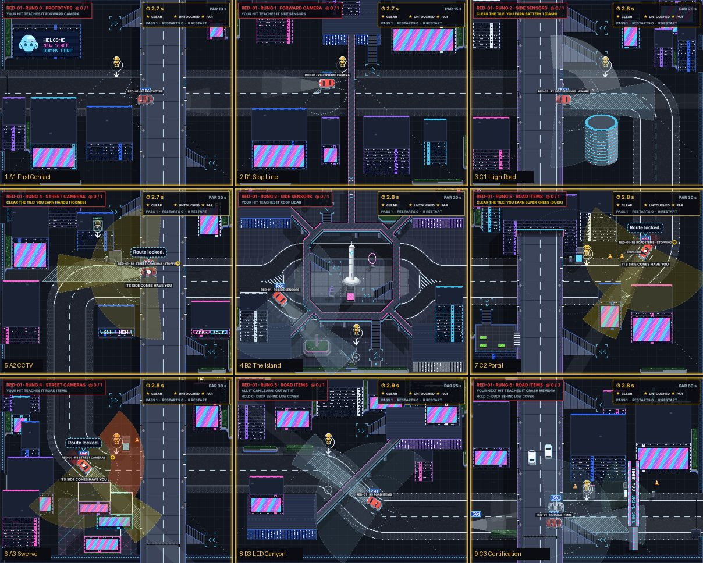

# DUMMIES GDD — Edit 115: Map 1 redesigned; the learner returns as a drone car

**8 November 2026 · Lawrence Lek.** Builds Edits 113–114. Sources: the tile inventory (`docs/DUMMIES_Level_Inventory.md`), the Edit 114 pressure test, probes v3 (`engine/p11_probe.js`). Governs `content/puzzles_map1.json`. Newest wins.

## 115.1 The escalation

- **Nine puzzles train one car.** RED-01 (sedan, Meridian) climbs rungs 0 → 7 over Map 1.
- **Certified, it returns on Map 2 as a drone car:** a Senior white car with every rung. Map 1's tricks fail on it.
- **Map 2 trains a new learner** (van, Porter); Map 3 another (police, Warden). Edit 114 §114.6.
- Proposed: `fleet.droneOf.<map>` (the certified learner's model), `fleet.droneShare` (its share of the white traffic).

## 115.2 Rules

- One new thing a puzzle. Each part is used on the puzzle after it is earned.
- Each puzzle uses its tile's architecture: highways and their parapet gaps, escalators, the island, the canyon.
- The kit is issued per test (`kit`), as in Hitman GO.
- No white traffic until the boss: `story.traffic.monument.<tile>` 0, decks included.
- The puzzle places its own pieces (`layout`, §115.5).
- The traffic-light switch and the clients move to Map 2, with the van.

## 115.3 The nine

| # | Tile | Name | Rung | NEW | Kit | Tile assets | Obvious → twist | Solution | Clear brings | Par / target |
|---|---|---|---|---|---|---|---|---|---|---|
| 1 | A1 | First Contact | 0 → 1 | The red car, blind | — | Open road under the Z1 highway | Walk into its side → your fault | Stand in its lane | Forward camera | 10 / 30 |
| 2 | B1 | Stop Line | 1 → 2 | Forward camera: its stop line | — | Open kerb by the podium skybridge; the near lane | Stand in its lane → it stops | Wait at the kerb; step in inside its line | Side sensors | 15 / 40 |
| 3 | C1 | High Road | 2 | Side sensors: it sees the kerb | — | Z2 highway, its east parapet gap over the road, two escalators | Wait at the kerb → seen; it stops short | Escalator up; drop through the gap as it passes | Battery 1 (dash) | 20 / 60 |
| 4 | B2 | The Island | 2 → 4 | Battery 1: the dash | Dash | The monument's island between the split lanes; a kiosk on it | Walk out → seen. Dash at its side → your fault | Cross to the island; hide behind the kiosk; dash ahead of its nose | Roof lidar, then street cameras | 20 / 60 |
| 5 | A2 | CCTV | 4 | Street cameras; a dash breaks a post | Dash | A cabinet on the kerb, one camera on it; the neon arcade | Hide behind the cabinet → the camera tells it | Break the post between passes; hide; dash | Hands 1 (cones) | 30 / 80 |
| 6 | A3 | Swerve | 4 → 5 | Hands 1: cones | Cones only | A kiosk by the road; two cones by the drop | No dash: seen at the kerb; it stops short | A cone in its lane; hide behind the kiosk; step into the other lane as it swerves | Road items | 30 / 80 |
| 7 | C2 | Portal | 5 | Road items: it stops for cones | Dash, cones | The portal tower's road; a kiosk with a breakable camera; two cones | A cone in its lane → it stops now | Break the camera; hide behind the kiosk; dash | Super Knees | 30 / 80 |
| 8 | B3 | LED Canyon | 5 | Super Knees: duck | Dash, Super Knees | The canyon's jog; a hedge and a planter by the road | Hide behind the hedge standing → it sees you over it | Duck behind the hedge; dash out | — | 25 / 70 |
| 9 | C3 | Certification | 5 → 6 → 7 | The boss | Dash, cones, Super Knees | Cabinet (no camera), hedge, kiosk (camera); the LED gateway; white traffic 0.5 | The same move twice → it remembers | Cabinet; ducked at the hedge; break the camera, use the kiosk | Arcade | 60 / 120 |

- **Grid order:** A1 → B1 → C1 → B2 → A2 → A3 → C2 → B3 → C3.
- **Parts:** the dash (3's clear) opens 4; cones (5's) open 6; Super Knees (7's) open 8 and the boss's hedge.
- **Car lessons:** at 1, 2, 4 (two) and 6; two mid-puzzle lessons in 9.
- **Puzzle 4 teaches two rungs:** roof lidar does not close a drop (§115.4), so it ships with street cameras. Built: `engine/p11.js`.
- **Puzzle 8 teaches nothing:** its card says Certification is next.

## 115.4 Verified (probes v3, 120 s a bot; the boss 200 s)

Counted hits / your-fault contacts, @ seconds to the first hit. Scripted checks set the move up by teleport.

| # | Puzzle | idle | stand | side | cut-in | cover | Intended move (scripted) | Status |
|---|---|---|---|---|---|---|---|---|
| 1 | First Contact | 0/0 | 1/0 @1.7 | 1/1 @11.2 | 1/0 @2.4 | 1/0 @2.9 | Stand in its lane | Verified |
| 2 | Stop Line | 0/0 | 0/0 | 1/2 @42 | 0/8 | 0/0 | Step in late (side bot) | Obvious fails; intended partly |
| 3 | High Road | 0/0 | 0/0 | 0/4 | 0/0 | 0/0 | Drop: 1/0 @2.9 | Verified |
| 4 | The Island | 0/0 | 0/0 | 0/1 | 0/0 | 0/0 | Spring from the kiosk: 0 | Obvious fails; intended unverified |
| 5 | CCTV | 0/0 | 0/0 | 0/1 | 0/0 | 0/0 | Break, then cover: 1/0 @29 | Verified. Drop also clears (84.5 s) |
| 6 | Swerve | 0/0 | 0/0 | 0/3 | 0/0 | 0/0 | Cone bait: 1/0 @92.5 | Verified; tight window |
| 7 | Portal | 0/0 | 0/0 | 0/2 | 0/0 | 0/0 | Cone: 0 (twist holds). Break, then cover: 0 | Obvious fails; intended unverified |
| 8 | LED Canyon | 0/0 | 0/0 | 0/3 | 0/0 | 1/1 @33.6 (ducked) | Duck, then dash | Verified |
| 9 | Certification | 0/0 | 0/0 | 0/2 | 0/0 | 0/3 | Break, then cover: 3 hits, cleared @8 | Verified |

- **Fixed from Edit 114:** no generic bot clears 2–9 now. v2's first-pass cheese (A3 4.6 s, B3 4.9 s) is gone.
- **Measured:** roof lidar (rung 3) does not close a deck drop. A2's drop hits at 90–120 px triggers at rungs 2 and 3; rung 3 grades it SEEN.
- **Untested by any bot:** 4's spring, 7's break-and-spring. Day 3 players decide them.

## 115.5 Layout data

- `layout.drop` [x, y]: the drone sets the dummy down here.
- `layout.cones`: [] removes the tile's cones; [[x, y], ...] sets their homes.
- `layout.cover`: [{kind, at, side, gap}].
  - `at`: 0..1 along the red car's route on screen.
  - `side`: left or right of travel, or N, S, E, W.
  - `gap`: from the kerb.
- `camera.watch` names the piece a street camera watches; `breakableCameras` lets a dash break its post.
- Kinds: planter 120 × 16, hedge 96 × 16 (low; a dash vaults them); cabinet 44 × 22, kiosk 30 × 20, billboard 64 × 12 (tall).
- Tall pieces stand north of a road running across.
- Code: `placeLayout` (`engine/duel.js`); drop, cones, camera (`engine/p11.js`).

## 115.6 Registry

| Value | Id | Status |
|---|---|---|
| The certified learner in the next map's fleet | `fleet.droneOf.<map>`, `fleet.droneShare` | Proposed |
| Kit per puzzle | `story.puzzle.kit.<tile>` | Proposed (Edit 113) |
| White traffic off on 1–8 | `story.traffic.monument.<tile>` 0 | Registered |
| Boss white traffic | `story.traffic.monument.C3` 0.5 | Registered |
| Par, target | `story.puzzle.par.<tile>`, `story.puzzle.target.<tile>` | Proposed |
| Pieces by the route | `layout` (puzzle data) | Proposed |
| Camera range | `perception.streetCameraRange` 180 | Registered |
| Dash reach | `movement.lungeDistance` 164 | Registered |
