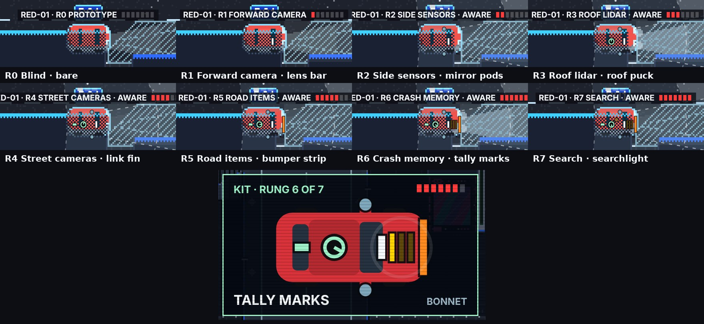

# DUMMIES GDD — Edit 116: Prototype 11.1, RED-01's kit

**9 November 2026 · Lawrence Lek.** Builds Edits 113–115. Governs the red car's look in Prototype 11.1 (`p11/index.html`). Prototype 11.0 is frozen at `p11_0/index.html`. Newest wins.

## 116.1 Rule

- **One icon.** The sedan silhouette, the red livery and the RED-01 tag stay fixed. Nothing is repainted or reshaped.
- **One piece a rung.** Each lesson bolts one piece into a fixed slot. Pieces accumulate.
- **A piece points where its sensor looks.** The nose looks forward, the mirrors outward, the roof all round.
- **A piece takes its field's colour.** The hardware and its field on the road read as one.

## 116.2 The kit

| Rung | Sensor | Piece | Slot | Colour | Live state |
|---|---|---|---|---|---|
| R0 | Blind | — | — | — | — |
| R1 | Forward camera | Lens bar | Windscreen top | White (`C.text`), as the beam | — |
| R2 | Side sensors | Two pods | Both mirrors | Steel blue (`#7fa8bc`), as the side cones | — |
| R3 | Roof lidar | Puck | Roof | Mint (`C.cam`) | Spins |
| R4 | Street cameras | Link fin | Rear roof | Mint (`C.cam`) | Pulses while a camera reports you |
| R5 | Road items | Bumper strip | Front bumper | Cone orange (`#ff8a1f`) | — |
| R6 | Crash memory | Three tally marks | Bonnet | Dummy yellow (`C.dummy`) | One fills a remembered spot, up to `duel.memorySites` 3 |
| R7 | Search | Searchlight | Roof, front | Search amber (`C.search`) | Blinks and sweeps while it searches |

- **R3 and R4 share mint.** Shape separates them: the puck spins, the fin pulses.
- **Replaces the halo** (`drawHalo`) in P11. Its lidar sweep and search beacon become pieces 3 and 7.

## 116.3 Where it shows

| Moment | Shows |
|---|---|
| Play | The kit over the sprite, scaled to the car (`c.L` × `c.W`, 50.4 × 25.2) |
| Tag | RED-01 · R*n* NAME, then seven squares, filled to the car's rung |
| A new rung | The newest piece glints: one ring a second for `duel.kitGlintSeconds` 3. It also glints at each puzzle's first pass |
| Lesson, clip | The kit as it was before the lesson |
| Lesson, fitting | The new piece appears as the drone lands. A close-up shows KIT · RUNG *n* OF 7, the piece lowered into its slot, its name and its slot |

- **At play scale, pieces are 2–4 px.** The tag's squares carry the count.
- **The fitting close-up teaches the piece once.** On the road, the colour ties it to its field.

## 116.4 Across maps (Edit 115 §115.1)

- **The Map 2 drone car is a white Senior with all seven pieces.** It reads as finished. Proposed with `fleet.droneOf.<map>`.
- **A new learner starts bare.** Porter, the van, fills the same slots, scaled to its body.
- **Not built:** Map 2.

## 116.5 Measured (9 November, headless Chromium)

| Check | Result |
|---|---|
| `engine/p11_test.js --boss 200` | Pass. The boss is cleared at 114 s with 3 hits; it reaches rung 7 after 2 mid-puzzle lessons. Each lesson shows the close-up |
| `engine/p9_tiles_test.js` (Submission 7) | Pass, 9 tiles. The kit is P11 only (`s.p11`); `index.html` is unchanged |
| Page errors | None |

## 116.6 Registry

| Value | Id | Status |
|---|---|---|
| Glint length | `duel.kitGlintSeconds` 3 | Proposed |
| Tally slots | `duel.memorySites` 3 | Registered |
| Squares on the tag | The ladder's top rung, 7 (`DUEL.RUNGS`, Edits 101–108) | Build value |
| Piece colours and slots | `KIT`, `C` in `engine/duel_ui.js` | Build values (art) |

## 116.7 Engine hooks

| Hook | Where | Does |
|---|---|---|
| `kitPieces(rung, o)` | `engine/duel_ui.js` | Draws the seven pieces in a unit car's frame (64 × 30, nose +x) |
| `drawKit(c)` | Field | Draws the live kit: spin, link pulse, tallies, search sweep. Holds the glint per sim |
| `kitTag` | `drawTag` | Draws the tag's squares |
| `kitInset` | `drawFit` | Draws the fitting close-up, on the side away from the car |
| Gate | `s.p11` | Submission 7 keeps the halo |
| Build | `build_p9.py --p11` | Labels the build P11.1 · PUZZLES |
