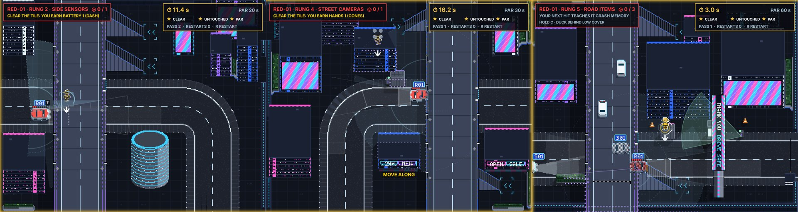

# DUMMIES GDD — Edit 117: Prototype 11.2, sensor feedback

**9 November 2026 · Lawrence Lek.** Builds Edit 116. Governs RED-01's marks in Prototype 11.2 (`p11/index.html`). Prototype 11.1 is frozen at `p11_1/index.html`. Newest wins.

- **Request (01:29):** "hatched area is overlapping with the front car lights too much … side sensors etc should show scan radius rather than just being on the car."
- **Method:** an adversarial UI agent judged the screenshots twice (`pipeline/ui_review.py`, `pipeline/agents/ui_adversary.md`).
  - Pass 1, on P11.1: 15 findings, 4 blockers.
  - Pass 2, on the fixes: 15 more, 2 blockers. Both are fixed here.
  - Runs: `pipeline/runs/20261109-013907-ui-p11_1`, `pipeline/runs/20261109-020655-ui-p11_2`; $1.93 and $1.92.

## 117.1 Rule

- **One sensor language.** Prototype 9's sensor marks are off in P11, for every car:
  - the forward hatch, the side outlines and the dotted fill;
  - the speech bubbles, the brake fans and the dummy's view edges.
- **The red car has no headlight wedge.** Its lamps stay.
- **A sensor shows what it does, not the hardware.** It draws its reach, its sweep and its returns out of its piece on the car. The kit is a label.
- **Its state shows as brightness in its own colour.**
  - Idle: a faint field and a pulse.
  - Sensing: brighter, with corner brackets on the dummy.
  - Never a yellow or red fill. Yellow is you; red is the car.
- **The ground fields obey the sim's sight.** Tall cover cuts them. Low cover cuts them while you duck. Deck tops cut them (out of its world). Parapet gaps stay open.

## 117.2 The fields

| Rung | Sensor | Feedback | Colour |
|---|---|---|---|
| 0 | Blind | Nothing: the plate and seven empty squares | — |
| 1 up | Forward camera | A ribbon along its lane, car width + 2 × `body.radius`, to its reach. Its first part is the too-late zone: `perception.reactionDelay` × v + v² / (2 × `traffic.hardBraking`) + `body.radius`. A stop bar with end ticks at the zone's end; STOPS HERE while braking. Pulses run out along it | White |
| 2 up | Forward cone | An edge only (± `perception.forwardConeAngle` 10°) | White, α 0.16 |
| 2 up | Side sensors | Two fans 10°–95° off the nose to the derived side reach (227). A dashed grade ring. Pings out of the mirror pods (`ui.scan.sidePingSeconds` 1.4, proposed). The fan that has you brightens and pings twice as fast | Steel blue #7fa8bc |
| 3 up | Roof lidar | A sweep round the puck to the derived side reach (proposed `perception.lidarRange`). A dotted reach ring. Returns fade behind the sweep (`ui.scan.lidarTurnSeconds` 1.2, proposed). They land on cover edges, deck edges and parapet gaps; on you only when you are in its world | Lilac #c3a6ff |
| 4 up | Street cameras | The pan cone always on (α 0.2). A 4-unit lens. LINKED as before | Mint #9ff2c8 |
| 5 up | Road items | Orange corner brackets on cones in its lane ahead | Orange #ff8a1f |
| 6 up | Crash memory | A red numbered ring per remembered spot (`duel.memoryRadius` 50). It goes solid within 220 of the car (proposed `duel.memoryWatchRange`). The crash marker is red, not yellow | Red #ff5a5a |
| 7 | Search | The ghost in red; one ring and its countdown (`duel.searchSeconds` 4); a red searchlight wedge sweeps onto it | Red |

- **On the dummy:**
  - corner brackets in the colour of the sensor that has you;
  - one notice arc, filling over `perception.sideNoticeSeconds` (× `perception.duckNoticeFactor` while ducked);
  - lidar returns as dots.
- **The car's label:**
  - Prototype 9's R01 plate stays;
  - seven squares under the plate, filled to the rung;
  - ? or ! beside it, white;
  - no tag text, pips, track bar or notice ring over the car.
- **Captions:** one at a time, in a band above the field's bottom, in the sensor's colour. ITS SIDE SENSORS HAVE YOU (one name). MOVE ALONG (no FARSIGHT).
- **HUD:** the panel and the strip fade to α 0.3 while the car or the dummy is under them.
- **Lunge guide:** yellow; it is yours.
- **Kit recoloured:**
  - the puck takes the lidar's colour;
  - the link piece becomes an antenna stub;
  - the tallies and the searchlight turn red.

## 117.3 Declined or open (Lawrence's call)

| Finding | State |
|---|---|
| The lesson card should add OPEN (the trick still open) | Declined. In P11 the open trick is the next puzzle's solution (Edit 113) |
| Lidar does not close the drop; lesson 3 claims it does | Open. Measured again: puzzle 4 still teaches rungs 3 and 4 together (§115.4) |
| One registry id per reach: `perception.forwardLength` 720 vs `perception.coneRadius` 340; six side reaches | Open. The draw follows the sim: rung 1 reaches `fwdLen`, rung 2 up 340 |
| Ray-cut the camera cone by tall cover | Not built. The sim's camera rule decides first |
| Cut MOVE ALONG | Kept: it is the anti-stall lift. FARSIGHT dropped from the line |
| Plate above the HUD | Not built. The HUD fade covers most of it |
| The close-up shows each piece emitting its field | Not built |

## 117.4 Measured (9 November, headless Chromium)

| Check | Result |
|---|---|
| `engine/p11_test.js --boss 200` | Pass. The boss is cleared with 3 hits, at rung 7, after 2 mid-puzzle lessons |
| `engine/p9_tiles_test.js` (Submission 7) | Pass, 9 tiles. Every change is gated on P11 |
| Page errors | None |

## 117.5 Engine hooks

| Hook | Where | Does |
|---|---|---|
| `drawScan(c, G)` | `engine/duel_ui.js` field | Draws the ribbon, the too-late zone, the stop bar, the fans and the forward edge on an offscreen layer. Then it erases each blocker's shadow (`shade`, `blockers`) and composites. Lidar, items, brackets and the notice arc go on top |
| `plateMarks` | `drawTag` | Draws the squares and ?/! under and beside Prototype 9's plate |
| `underHud` | `hud`, `P11_UI.strip` | Fades the HUD |
| Build patches | `engine/build_p9.py --p11` | Turns off `drawZones`, the bubbles, the brake fan and `drawViewEdges` when `window.P11` is set. Exposes `__dummiesHits` for QA |

## 117.6 Registry

| Value | Id | Status |
|---|---|---|
| Forward pulse, side ping, lidar turn | `ui.scan.forwardPulseSeconds` 1.1, `ui.scan.sidePingSeconds` 1.4, `ui.scan.lidarTurnSeconds` 1.2 | Proposed |
| Lidar reach | `perception.lidarRange` (= derived side reach, 227) | Proposed |
| Memory ring goes solid | `duel.memoryWatchRange` 220 | Proposed |
| Too-late zone | `perception.reactionDelay` 0.3, `traffic.hardBraking` (TUNE.redHard), `body.radius` 13 | Registered |
| Side fans | `perception.sideConeAxis` 52.5, `perception.sideConeAngle` 42.5, `perception.coneRadius` 340 × `perception.sideConeRatio` | Registered |
| Camera cone | `perception.streetCameraRange` 180, `perception.streetCameraFov` 60 | Registered |
