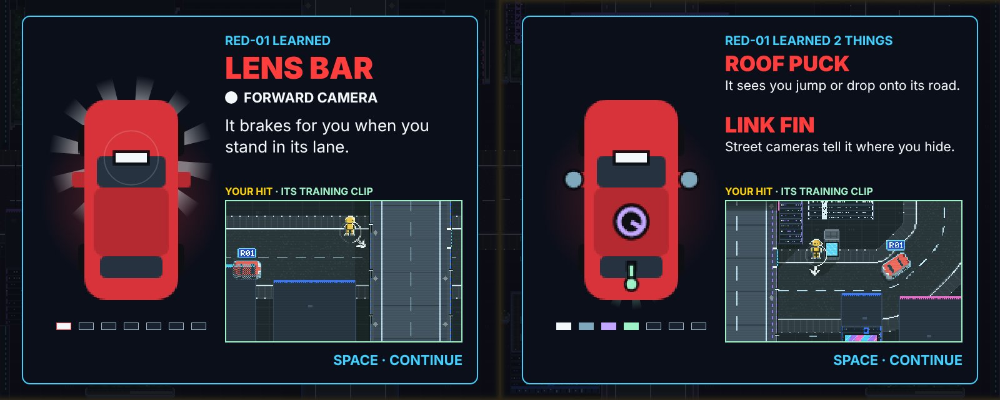

# DUMMIES GDD — Edit 119: Prototype 11.3, the snake order, the pad layout, the car's upgrade screen

**9 November 2026 · Lawrence Lek.** Builds Edits 115–118. Governs Prototype 11.3 (`p11/`). P11.2 frozen at `p11_2/`. Newest wins.

- **Request (12:00):** "The playthrough skipped C2? It should go A1, B1, C1, C2, B2, A2, A3, B3, C3. Also, have a UI adversarial redesign agent redesign the car upgrade screen. It should look similar to the 'Dummy Chassis' upgrade screen, with (1) the replay video, (2) the new part arriving on the car with juice and like an upgrade, and (3) a simple sentence saying what the car learned. Also, it is essential that a button is gained for 'crouch', What about - A for Dash, B for crouch, X for Jump, Y for interact (e.g. cone)."
- **C2 was not skipped.** Edit 115 played it 7th (A1 B1 C1 B2 A2 A3 C2 B3 C3).

## 119.1 The snake order

The puzzles run in a snake across the grid: row 1 east, row 2 west, row 3 east. Each puzzle borders the last.

- **Roles stay in sequence.** Puzzles 4–7 keep their place in the escalation. Each moves onto the tile its number now lands on.
- **Tile-bound:** the tile's art, its landmark line, the drop. **Role-bound:** rungs, kit, earn, cover piece, camera, twist, hints, par.
- **Names follow the landmark or the mechanic.**

| # | Tile | Name | Role (from Edit 115) | Rungs | Kit | Earns | Cover · camera | Cones |
|---|---|---|---|---|---|---|---|---|
| 1 | A1 | First Contact | Unchanged | 0 → 1 | — | car | — | — |
| 2 | B1 | Stop Line | Unchanged | 1 → 2 | — | car | — | — |
| 3 | C1 | High Road | Unchanged | 2 | — | Battery 1 | — | — |
| 4 | **C2** | Portal | Was B2 (The Island) | 2 → 4 | Battery 1 | car | Kiosk, N, `at` 0.5 | — |
| 5 | **B2** | CCTV | Was A2 (CCTV) | 4 | Battery 1 | Hands 1 | Cabinet, N, `at` 0.5 · camera on it, breakable | — |
| 6 | **A2** | Swerve | Was A3 (Swerve) | 4 → 5 | Hands 1 | car | Kiosk, N, `at` 0.42 | 2, north of the drop |
| 7 | **A3** | The Stacks | Was C2 (Portal) | 5 | Battery 1, Hands 1 | Super Knees | Kiosk, N, `at` 0.57 · camera on it, breakable | A3's 2 |
| 8 | B3 | LED Canyon | Unchanged | 5 | Battery 1, Super Knees | — | Hedge, planter | — |
| 9 | C3 | Certification | Unchanged | 5 → 7 | All three | — | Cabinet, kiosk, hedge · camera | 2 |

- **Data:** `content/puzzles_map1.json` (`map.order` and the `n` of each puzzle). The grid unlocks in this order (`P11.ORDER`).
- **Cover placement:** each cover sits where a dummy fits behind it (26 units). Edit 118 found none behind A2's cabinet. B2's cabinet and C2's and A2's kiosks have room.

### Solved with the pad

Each re-homed puzzle was tuned on the headless sim, then played in the browser through the virtual pad. Scripts: `qa/solutions/<tile>.json`.

| # | Tile | The pad clears it by | Window (headless) | Browser | Twist checked |
|---|---|---|---|---|---|
| 4 | C2 | Hide at the kiosk's west (downstream) side; walk into its lane as its nose nears | Nose 45–65, pass 1 | ★★★ 4.8 s | From the open kerb: no clear (nose 45–65) |
| 5 | B2 | Dash into the camera post; hide where it stood; walk into its lane | Nose 80–100, pass 1 | ★★★ 6.6 s | Camera up: no clear (nose 80–110) |
| 6 | A2 | Y picks up a cone; Y drops it in its lane; hide at the kiosk; step into the swerve (22 units south of its lane) | Nose 100–120, pass 2 | ★★★ 11.6 s | **No cone: still clears** (nose 60–100). Edit 115's A3 did too (nose 140). §119.4 |
| 7 | A3 | Dash into the camera post; wait one dash (164) north of its lane, behind the kiosk; dash as it nears. Edit 115's move | Nose 50–70, pass 2 | ★★★ 15.2 s | Camera up: no clear. Walk-out on a later pass: no clear |

- **Puzzle 7 now clears with Edit 115's dash.** The hide sits about one dash from the lane, as §118.7 proposed.
- **Full runthrough, snake order:** nine puzzles on the first try; every menu; save, reload, continue; Certification; Arcade. 4 min 48 s; no page errors (§119.5).

## 119.2 The pad layout

| Button | Verb | Keys | Fitted by | Locked shows |
|---|---|---|---|---|
| A | Dash | Space, K | Battery 1 | DASH · NOT FITTED |
| B (hold) | Crouch | C, Ctrl, L, Shift | Super Knees | ??? · Super Knees fits it |
| X | Jump | J | Legs 1 (not in Map 1) | Denied: locked |
| Y | Interact: pick up / put down a cone | E, I, Q | Hands 1 | Denied: locked |

- **B is gained.** The touch diamond's B is dim until Super Knees is fitted. Then it reads CROUCH.
- **LB, RB and LT still crouch** (Edit 118). Enter still confirms.
- **Touch:** A DASH, B CROUCH, X JUMP, Y GRAB / DROP. Each lights when fitted.
- **HUD key hints:** pad "B CROUCH", keys "C CROUCH"; "Y GRAB" / "Y DROP" (keys E).
- **Controls screen:** DASH (Space / K · A), CROUCH (C / Shift · B), JUMP (J · X), INTERACT (E / I · Y), PAUSE.
- **Gamepad setup:** "DASH, CROUCH, JUMP, USE in turn".
- **Texts:** "HOLD B (KEYS: C) · CROUCH BEHIND LOW COVER"; the part card: "Crouch: hold B (keys: C)". "Duck" is now "crouch" on screen.
- **Build:** patches in `engine/build_p9.py` (`p11_game_js`), all gated on `window.P11`. The sim is unchanged: P11 maps X to its jump command and Y to its cone command. Submission 7 keeps its layout.
- **Measured (browser):** pad B crouches on B3 (Super Knees) and not on A3; C and Shift crouch; X is denied (no Legs); Y picks up a cone and puts it down; E picks up.

## 119.3 The car's upgrade screen

### Method

| Step | Agent / tool | Output |
|---|---|---|
| Spec | Adversarial UI redesign agent (`pipeline/agents/ui_upgrade.md`, opus). Read 32 shots: the Dummy Chassis gift screen frame by frame, and the P11.2 lesson | `pipeline/runs/20261109-122807-upgrade-spec/` ($1.02) |
| Build | `engine/duel_ui.js` `upgrade()`, P11 only | P11.3 |
| Review 1 | The same agent against its own 12 acceptance checks. 42 pinned shots (`engine/p11_upgrade_shots.js`): A1, B1, C2, A2, and reduced motion | 10 of 12 pass; 7 findings (U1–U7), all fixed. `pipeline/runs/20261109-124026-upgrade-review-r1/` ($1.21) |
| Review 2 | The same, on the fixed build | 12 of 12 pass; 7 findings, all fixed. `pipeline/runs/20261109-125540-upgrade-review-r2/` ($1.13) |
| Review 3 | The same, on the build after review 2 | 12 of 12 pass; 6 findings, all fixed. `pipeline/runs/20261109-130607-upgrade-review-r3/` ($1.10) |

Run: `python3 pipeline/ui_upgrade.py spec --brief "…"`, then `review --spec <run>/a_upgrade_spec.json`.

### The verdict on P11.2's lesson

- It read as a log entry, not a reward. 5.8 s over three beats before the one sentence.
- The hit played full-field; RED-01 was about 50 px. A second, tiny drone fitted the piece in the world.
- It closed on a red text wall: rung numbers, CLOSED and NEXT rows, a yellow ENTER.

### The screen

The Dummy Chassis gift screen's family: the same panel, hero left, text right, landing hit, name pop, cyan prompt.

| Region | Box (1280 × 720) | Holds |
|---|---|---|
| Panel | 276, 66, 728 × 588 | #0b0f1a, 2 px cyan frame. The HUD columns stay and do not shake |
| Hero column | 300, 90, 290 × 454 | RED-01 nose up, the kit sedan at 5×, pixel-scaled; red glow; rays in the new piece's colour from the car's centre. Rays, rings and flash fade before the column's edge |
| Ladder | 330, 556, 240 × 16 | Seven pips in the kit colours, on a plate. No numbers. Rung 1's white pip is outlined red |
| Label | 600, 96 | "RED-01 · NEW PART INCOMING", then "RED-01 LEARNED" |
| Name | 600, 124, 380 × 48 | The piece: LENS BAR, MIRROR PODS, ROOF PUCK … Red, Nunito 900 |
| Sensor line | 600, 184 | A dot in the kit colour; the sensor's name |
| Sentence | 600, 222, 380 × 102 | One sentence (below) |
| Replay | 600, 360, 380 × 228 | "YOUR HIT · ITS TRAINING CLIP". A 456 × 274 crop of the field, between the car a second before the hit and the impact |
| Prompt | right edge 980, y 606–630 | "A · CONTINUE" (pad), "SPACE · CONTINUE", "TAP · CONTINUE" |

### The timeline (seconds, proposed `ui.upgrade.*`)

| t | Beat |
|---|---|
| 0–0.3 | Veil; the panel scales 0.86 → 1 (back-ease). The car dimmed to 60%, its new slot empty, bracketed in the kit colour |
| 0.2–1.1 | The replay: the last 0.9 s to your hit |
| 0.3–0.85 | The drone comes down to y 150, above the car. The piece hangs on its tether above the nose (y ≤ 180); the pods on a split tether |
| 0.85–1.1 | Let go. The piece falls the full way into its slot: 1.15× over a 6 px shadow, three ghost trails. The drone climbs out |
| **1.1** | **The landing falls on the replay's frame of impact** (the frame 0.05 s before the hit, before the game's struck look). Yellow box on the dummy. Panel shake 6 px; the piece flashes white; a red ring and a ring in the kit colour; 12 sparks; a white burst on the car's column; the pip fills; the rays start |
| 1.1–1.38 | "RED-01 LEARNED". The name pops (capped to its column) |
| 1.3–1.5 | The sentence fades and rises in |
| 1.6 | The prompt (2.1 for two pieces). The replay loops from the first frame with the car wholly in view (−2.0 to −1.6 s), with a 0.5 s hold on the impact and a 0.1 s dip between loops |

- **Two rungs** (puzzle 4: roof lidar, street cameras): one screen. The drone brings both pieces. After the first lands it flies the second over the car to its slot, lets go at 1.45, and the piece settles at 1.6 (rings, flash, glint, pip; no shake, no sparks). Two names, two sentences, "RED-01 LEARNED 2 THINGS". Prompt at 2.1. On continue the sim fits the second rung (`P11.lessonPair`). Before: two full lessons back to back.
- **Boss lessons** (C3, between hits): the same screen, one piece each.
- **Input:** a press in the first 0.25 s is ignored. A press before the prompt settles the screen. The next press continues. A tap anywhere on the field counts.
- **Reduced motion:** no drone, shake, flash or sparks. The piece fades into its slot (0.4–0.7). Static rays at 0.14. Name at 0.6, sentence at 0.75, a steady prompt at 1.0. The replay keeps its normal clock.
- **Sound:** the gift fanfare's shape, a fourth lower and square: whoosh, thud, arpeggio, chord, one ping a piece.
- **Under a deck** the game dithers a car. The replay draws RED-01 solid there.

### The sentences

| Rung | Piece | Sentence |
|---|---|---|
| 1 | Lens bar | It brakes for you when you stand in its lane. |
| 2 | Mirror pods | It spots you beside the road and stops short. |
| 3 | Roof puck | It sees you jump or drop onto its road. |
| 4 | Link fin | Street cameras tell it where you hide. |
| 5 | Bumper strip | It stops for a cone instead of swerving into you. |
| 6 | Tally marks | It remembers every spot you hit it from. |
| 7 | Searchlight | If it saw you, it searches where you were last. |

### Cut

- The full-field clip and hold; the world-view fitting; the 320 × 178 kit inset.
- Every rung number; "TRAINING LOG", "LESSON:", "Your hit: FRONT CORNER · STRUCK".
- The long rung text, CLOSED and NEXT. The next puzzle belongs on its own card.
- REC, the clip clock, the green impact box. The red card frame; the yellow ENTER.

### Review 1 (all fixed in P11.3)

| Id | Finding | Fix |
|---|---|---|
| U1 | The drone came down onto the car | The drone holds at y 150; the tether lengthens; the pods hang on a split tether |
| U2 | The name pop ran off the panel (MIRROR PODS, BUMPER STRIP) | Peak scale capped at 392 px of width |
| U3 | The rays ended in a hard grey box | Rays and glow fade out by 145 px; rings stop at 145 |
| U4 | The panel flash greyed the replay at the impact | A white burst on the car's column only; both rings at the landing |
| U5 | The loop restarted with the car half out of the box | The loop starts with the car wholly in view; 0.1 s dip |
| U6 | Under A2's deck the replay showed a dithered car | The car drawn solid in the replay |
| U7 | The bumper strip stuck out past the nose | Seated 2.5 units inside the nose on this screen |

### Review 2: 12 of 12 checks pass (all fixed in P11.3)

`pipeline/runs/20261109-125540-upgrade-review-r2/` ($1.13).

| Id | Finding | Fix |
|---|---|---|
| U1 | A2's rays and rings cut flat at the column's top (the bumper sits 122 px from it) | Rays, rings and the flash fade by each slot's distance to the column edge, less 8 px |
| U2 | C2's second landing covered the pips | The hero layer stops at y 544; the pips sit on a plate |
| U3 | C2's replay restarted its loop at the second landing | The loop starts at the prompt: 2.1 s for two pieces |
| U4 | A carried piece sat on the car body | Carried pieces stay above the nose until let go; airborne at 1.15× over a shadow |
| U5 | Rung 1, all white, was the dullest upgrade | Red glow 0.30; rays 0.45; the new pip outlined red |
| U6 | Reduced-motion rays too bright | 0.14 |
| U7 | At the impact hold RED-01 showed the game's faded struck look | The hold uses the frame 0.05 s before the hit |

### Review 3: 12 of 12 checks pass (all fixed in P11.3)

`pipeline/runs/20261109-130607-upgrade-review-r3/` ($1.10). Fixes checked on pinned shots, not by a fourth round.

| Id | Finding | Fix |
|---|---|---|
| U1 | Two pieces: the link fin slid 260 px down the car from the nose | The drone flies the fin over the car to 44 above its slot (1.1–1.45), lets go; it settles 1.15× → 1× with trails (to 1.6). Then the drone climbs out |
| U2 | Two pieces: no lingering rays once settled (the rear slot sits near the column's foot) | The lingering rays radiate from the car's centre on every screen |
| U3 | Reduced motion: the replay looped before reaching the impact | The replay keeps the normal clock; only the prompt comes early (1.0) |
| U4 | Mirror pods: one burst between the pods, on the old lens bar | A ring pair and a 6-line burst on each pod |
| U5 | The name pop could pass the panel's edge | Capped (Review 2) and clipped to the text column |
| U6 | Rung 1's pip outlined red on A1 only | Outlined whenever rung 1 is earned |

## 119.4 Design calls (Lawrence's)

| Call | Options | Evidence |
|---|---|---|
| Puzzle 6 (A2) clears without a cone: a plain step-out from the kiosk | Move the kiosk so the walk is too long without the swerve. Or make the swerve the only gap in its side sensors | Nose 60–100 clears with no cone; with a cone, nose 100–120. Edit 115's A3 also cleared without one (nose 140) |
| Puzzle 4 (C2) clears by a walk-in, not the dash | As §118.7: end the dash at the lane, or set cover about 136 from the lane | 0 dash clears from the kiosk (12 runs, two angles) |
| Map 1 has no jump; X is always denied | Keep X as a locked verb that teaches the layout. Or fit Legs 1 on a Map 1 tile | §119.2 |

§118.7's other calls stand: pass-1 clears, the deck drop, Z1 stairs, cone pickup.

## 119.5 Tests

| Test | Result |
|---|---|
| Headless solutions, nine puzzles | Eight clear ★★★ (B3 ★·★ in the browser); C3 by the cut-in bot |
| Browser, the six changed and checked puzzles (`qa/attack.js`) | 6 of 6 cleared; 0 monitor findings |
| `engine/p11_test.js --boss 200` | Flow, R, hint, save, camera break; boss certified in 123 s: 3 hits, rung 7, 2 lessons through the new screen |
| Pad remap (browser) | §119.2 |
| Full runthrough (`qa/runthrough.js`, P11.3 final) | Pass: nine puzzles on the first try in the snake order, every menu, save and reload, Certification, Arcade. 4 min 48 s; no page errors. ★★★ on A1–A3; B3 ★·★; C3 ★★· ([video](p11_runthrough.mp4)) |

## 119.6 Registry

| Value | Id | Status |
|---|---|---|
| Pad layout | Input map: A dash, B crouch (hold), X jump, Y interact; keys Space/K, C/Ctrl/L/Shift, J, E/I/Q | Build value (P11) |
| Landing | `ui.upgrade.landSeconds` 1.1 | Proposed |
| Second landing | `ui.upgrade.land2Seconds` 1.6 | Proposed |
| Prompt | `ui.upgrade.promptSeconds` 1.6 (2.1 for two) | Proposed |
| Input guard | `ui.upgrade.guardSeconds` 0.25 | Proposed |
| Replay crop | `ui.upgrade.cropW` 456, `ui.upgrade.cropH` 274 | Proposed |
| Loop hold | `ui.upgrade.holdSeconds` 0.5 | Proposed |
| Hero scale | `ui.upgrade.carScale` 5 | Proposed |
| Cover, C2 · B2 · A2 · A3 | `at` 0.5 · 0.5 · 0.42 · 0.57; `side` N; `gap` 2 | `content/puzzles_map1.json` |

## 119.7 Files

- `content/puzzles_map1.json`: the snake order; puzzles 4–7 re-homed.
- `engine/build_p9.py`: the pad layout patches; P11's part texts; the lesson's device, motion, sound and tap.
- `engine/duel_ui.js`: `upgrade()`, the replay crop and loop, the sentences.
- `engine/p11.js`: `P11.lessonPair`; two rungs on one screen.
- `engine/p11_upgrade_shots.js`; `pipeline/ui_upgrade.py`; `pipeline/agents/ui_upgrade.md`; `pipeline/inputs/p11_upgrade_context.md`.
- `qa/headless.js` (Y is the cone, X the jump, B the crouch); `qa/solutions/{C2,B2,A2,A3}.json`.
- `p11_2/`: Prototype 11.2, frozen.
