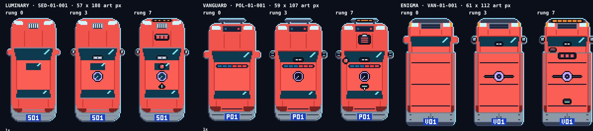
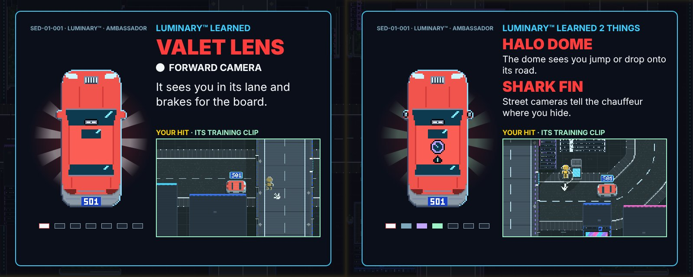

# DUMMIES GDD — Edit 120: Prototype 11.4, crouch toggle, the LUMINARY™, the hero car

**9 November 2026 · Lawrence Lek.** Builds Edit 119. Governs Prototype 11.4 (`p11/`). P11.3 frozen at `p11_3/`. Newest wins.

- **Request (14:42):** "B crouch is toggle on or off by default (can change this in settings - controls). Get a design agent to design a more graphically appropriate big car icon for upgrades, consistent with the rest of the level style. RED-01 should have a specific model number, taken from the style guide. In NOX, the cars are called via classes. LUMINARY (CEO car), VANGUARD (police car), ENIGMA (delivery car), GENESIS (sports car). this can be Luminary(TM) model to start with. Then for next maps VANGUARD (police/security car), and ENIGMA. The upgrades can be also relevant to the functioning of each car."

## 120.1 Crouch: a toggle by default

| Mode | B (keys C, Ctrl, L, Shift; LB, RB, LT; touch B) | Default |
|---|---|---|
| Toggle | A press crouches. The next press stands | Yes |
| Hold | Crouched while held (P11.3) | No |

- **Setting:** pause → Controls → "Crouch: toggle" / "Crouch: hold". Enter switches it. Saved in the browser (`dummies.p11.crouch`).
- **Stands up:** a new body, a restart (R), any phase but play, a puzzle without Super Knees.
- **Feedback:** the key hint reads B STAND while crouched (toggle); B CROUCH otherwise.
- **Texts:** "PRESS B (KEYS: C) · CROUCH BEHIND LOW COVER" (hold: "HOLD B"). Controls: "Press: crouch or stand". Part card: "Crouch: B (keys: C). Press to crouch, again to stand."
- **Measured (browser, B3):** pad B on, still on after 1 s, B off; C on, C off. Controls switches to hold, saved; hold: B down crouches, B up stands.
- **Tests:** `qa/solutions/B3.json` presses C (toggle). The cut-in bot (`engine/p9_play_test.js`) sets hold for itself. `qa/headless.js`: a C press toggles.

## 120.2 The learner is a model: LUMINARY™ SED-01-001

| Map | Class (NOX) | Model ID | Tag | Fleet line | Callsign | Job (fleet.json) | Status |
|---|---|---|---|---|---|---|---|
| 1 Monument | LUMINARY™, the CEO car | SED-01-001 | S01 | Meridian Imperial | Ambassador | Chauffeurs the board | Built |
| 2 Parkland | VANGUARD™, police and security | POL-01-001 | P01 | Warden Imperial | Marshal | Escorts dignitaries and parades | Designed |
| 3 Waterfront | ENIGMA™, delivery | VAN-01-001 | V01 | Porter Imperial | Concierge | White-glove deliveries to penthouses | Designed |
| — | GENESIS™, the sports car | SPT-01-001 | R01 | Comet Imperial | Aurum | Carries signed contracts between towers | Named; no map |

- **Source:** the classes are NOX's (Lawrence). Model IDs, lines, callsigns and jobs: `engine/p9/fleet.json`, the roster Style Guide V2 rule V7 binds. Format `CLASS-TIER-NNN`; tier 01 Luxury.
- **Replaces** RED-01 in P11: the car's roof plate (S01), the HUD ("LUMINARY™ · RUNG 3 · ROOF LIDAR"), the upgrade screen ("LUMINARY™ LEARNED"; "SED-01-001 · LUMINARY™ · AMBASSADOR"), the tales ("The Luminary™ now watches both kerbs.").
- **Red stays.** Red means the learning car. The class shows in silhouette and parts.
- **Supersedes** Edit 114 §114.6's proposal (Parkland a van, Waterfront a police car). Parkland is VANGUARD; Waterfront is ENIGMA.
- **Data:** `content/puzzles_map1.json` `map.learner`, `map2.learner`, `map3.learner`. Sim: `T.learner` names the red car's model (`c.model`); Submission 7 keeps RED-01.

## 120.3 The hero car: the car design agent

### Method

| Round | The car design agent (`pipeline/agents/car_designer.md`, opus) | Result |
|---|---|---|
| 1 Design | Read the level's own sprites (every class, 1× and 4×), play, the gift screen, the P11.3 screen. Wrote a spec and `engine/hero_cars.js` | Three hero cars, 21 parts, slots, sentences |
| 2 Review | Its renders: a sheet per class (rungs 0, 3, 7; each part alone; 1×) and the upgrade screen | 9 findings (D1–D9), all fixed in its module; the host now prints its model label (D9) |
| 3 Review | The same | 9 findings (E1–E9); 8 fixed, E4 by the host |
| 4 Review | Resumed on the module and host as they stood | 3 findings (F1–F3); F1, F2 fixed; F3 by the host |

- **Run:** `pipeline/runs/20261109-145257-car-design/` (rounds 1–3 $3.94). `python3 pipeline/car_design.py --brief "…" --rounds 3`; `--resume <run>` adds a review round.
- **Contract:** the agent writes one browser module, `window.HERO_CARS`: `classes`, `kit`, `slots`, `sentences`, `body(g, cls, o)`, `piece(g, cls, n, o)`. It draws through the host's pixel API `g` (`engine/duel_ui.js` `heroG`): `px, rect, line, disc, ellipse, poly, outline, rim, mirror`, the level palette, the rung colours, the learner's red recolour.
- **Renders:** `engine/car_design_shots.js` (`--ref` the level's style; `--preview` the agent's cars).

### Its verdict on the P11.3 hero

- A vector sedan, pixel-scaled. Flat red, no rim, no extrusion, no lights. "Clip art pasted over the level."

### The rules it took from the level

- A red top face; a grey rear face below it (the extrusion); a 1-px rim, light from the top right (`carRim` #8FDFFF, `carRimD` #3A4A66).
- Stair-stepped glass bands with a 2-px 45° glint; head and tail lights in the corners; the in-level tag on the rear plate (S01, P01, V01).
- Symmetric bodies: the left half drawn, then mirrored. One art px = 3 screen px.

### The cars

| Class | Buffer (art px) | Silhouette |
|---|---|---|
| LUMINARY™ | 57 × 108 | A stretched executive sedan: long bonnet, long roof, a sunroof, long boot. A grille and mascot on the nose |
| VANGUARD™ | 59 × 107 | Wider and shorter. A gunmetal push bar ahead of the nose; a light bar across the roof front |
| ENIGMA™ | 61 × 112 | Cab-forward van. The cargo box steps out wider; three roof ribs; a tall rear face with doors |

- **On screen:** the car centred on the hero column at 3×; slots, brackets, rings and tethers from `slots`.
- **Model line:** "SED-01-001 · LUMINARY™ · AMBASSADOR", label ink #7FA8BC, top of the hero column. It fades in after the drone leaves.
- **Under a deck** the replay still draws Edit 119's solid stand-in.

## 120.4 Parts by class: the same sensor, the car's own hardware

The rung, its sensor and its colour stay fixed (the sensor language). The part that brings it is the car's own hardware.

| Rung | Sensor | LUMINARY™ (CEO car) | VANGUARD™ (police) | ENIGMA™ (delivery) |
|---|---|---|---|---|
| 1 | Forward camera | VALET LENS: a chrome lens bar, windscreen top | DASH CAM: a box, white lens, REC dot | CAB CAM: a bar at the cab windscreen |
| 2 | Side sensors | MIRROR EYES: lenses in both mirror caps | PLATE READER: twin lenses on each mirror | WING EYES: a lens filling each van mirror |
| 3 | Roof lidar | HALO DOME: flush glass dome, violet ring, a turning sweep | SPEED LIDAR: an octagonal turret, a turning hand | DOCK LIDAR: a puck on a cross-bar over the box |
| 4 | Street cameras | SHARK FIN: a fin aerial, mint link strip | RADIO MAST: a mint light and a whip | TRACKER: a telematics box, mint LEDs |
| 5 | Road items | PARK RADAR: four orange sensor dots | BAR RADAR: an orange slit along the push bar | KERB RADAR: an orange strip on the bumper |
| 6 | Crash memory | LEDGER: a chrome plate, a red lamp a crash spot | CASE FILE: a clipboard, a red tally line a spot | MANIFEST: a board on the box header |
| 7 | Search | SUNROOF LAMP: a lamp risen through the sunroof | PILLAR SPOT: an A-pillar spotlight | DOOR LAMP: a work lamp, cab corner |

- **Why (LUMINARY™):** a chauffeur car keeps the board's ride smooth; it hides sensors in its mirrors; it keeps lidar flush under glass; it already has a shark fin and parking sensors; the board's car keeps minutes; the chauffeur never steps out.
- **Sentences (LUMINARY™), on the upgrade screen:**
  1. It sees you in its lane and brakes for the board.
  2. Its mirrors now watch the pavements on both sides.
  3. The dome sees you jump or drop onto its road.
  4. Street cameras tell the chauffeur where you hide.
  5. It stops for cones now, instead of swerving round them. *(Rung 5 rewritten by the host for all three classes: the agent's "reads cones" lost the change that matters in puzzle 7.)*
  6. It logs every crash spot and slows there next time.
  7. It stops, raises the lamp and searches where it lost you.
- **VANGUARD™ and ENIGMA™** are drawn and named, not yet played: their maps are not built. The in-level kit (Edit 116) keeps its slots.

## 120.5 Tests

| Test | Result |
|---|---|
| Crouch, browser (B3) | Toggle: pad B on, still on after 1 s, B off; C on, C off. Controls switches to hold and saves it; hold: B down on, B up off |
| Headless solutions, eight puzzles | All clear ★★★ (B3 by C presses, the toggle) |
| `engine/p11_test.js --boss 200` | Flow, R, hint, save, camera break; boss certified in 71 s: 3 hits, rung 7, 2 lessons through the new screen |
| Hero renders (`engine/car_design_shots.js --preview`) | Three classes, all parts, the upgrade screen: no page errors |
| Full runthrough (`qa/runthrough.js`) | Pass: nine puzzles on the first try, every menu, save and reload, Certification, Arcade. 5 min 59 s; no page errors. B1 and B3 ★·★; C3 ★★·; the rest ★★★ ([video](p11_runthrough.mp4)) |

- **Fixed on the way:** P11.3 never set the screen's settled flag (`L.card`): a comment swallowed it in Edit 119's last fix. Players were unaffected (the input reads the clock); the test bot waited forever in the boss's lessons. Restored.

## 120.6 Registry

| Value | Id | Status |
|---|---|---|
| Crouch mode | `input.crouchMode` toggle (hold) | Proposed; build value toggle, saved per browser |
| Learner, Map 1 | `story.learner.monument` SED-01-001 | Proposed; `map.learner` |
| Learner, Map 2 | `story.learner.parkland` POL-01-001 | Proposed |
| Learner, Map 3 | `story.learner.waterfront` VAN-01-001 | Proposed |
| Hero scale | `ui.upgrade.heroScale` 3 (art px to screen px at 1280 × 720) | Proposed |

## 120.7 Files

- `engine/hero_cars.js`: the hero cars, written by the car design agent (round 4).
- `engine/duel_ui.js`: `heroG` (the pixel API), `heroCanvas`; the upgrade screen draws the class's hero, slots, part names, sentences and model line; the HUD names the learner.
- `engine/p11.js`: `P11.LEARNER`; `T.learner`. `engine/duel.js`: the red car's model from `T.learner` (Submission 7: RED-01).
- `engine/build_p9.py`: the crouch toggle (`CROUCH`, `p11Crouch`), its Controls item and texts; `hero_cars.js` bundled into P11.
- `content/puzzles_map1.json`: `map.learner`, `map2`, `map3`; tales name the Luminary™; crouch texts.
- `engine/car_design_shots.js`; `pipeline/car_design.py`; `pipeline/agents/car_designer.md`.
- `qa/headless.js` (C toggles); `qa/solutions/B3.json`; `engine/p9_play_test.js` (the bot holds).
- `p11_3/`: Prototype 11.3, frozen.
