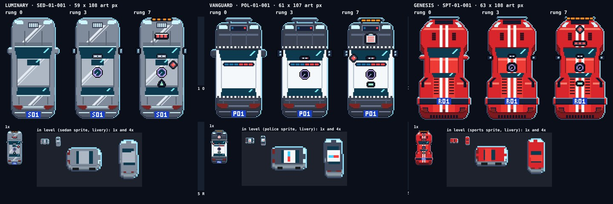
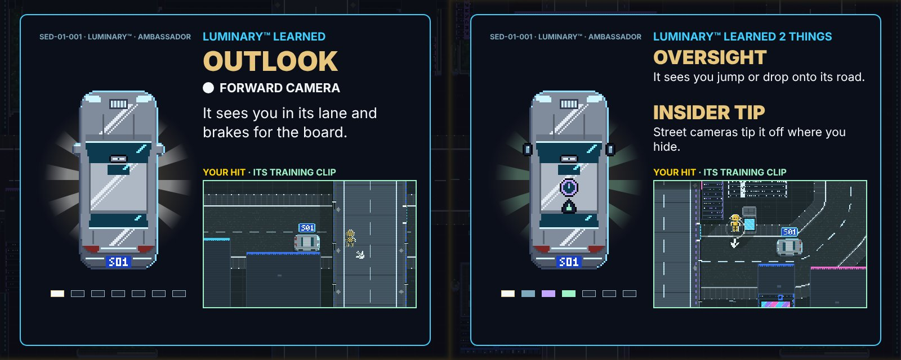

# DUMMIES GDD — Edit 121: Prototype 11.5, liveries, GENESIS™, part names

**10 November 2026 · Lawrence Lek.** Builds Edit 120. Governs Prototype 11.5 (`p11/`). P11.4 frozen at `p11_4/`. Newest wins.

- **Request (22:22):** "how about for new colour scheme- grey-metallic car luminary, then white and black vanguard police car, then instead of enigma can we do 'genesis' which is a racing car, red car. So they are all 'higher class' cars too. as it progresses. Try a bit smarter with the upgrade names, befitting the function."

## 121.1 The learners: a rising order

| Map | Class | Model ID | Tag | Livery | Fleet line · callsign · job | Status |
|---|---|---|---|---|---|---|
| 1 Monument | LUMINARY™, the CEO car | SED-01-001 | S01 | Grey metallic | Meridian Imperial · Ambassador · chauffeurs the board | Built |
| 2 Parkland | VANGUARD™, the police and security car | POL-01-001 | P01 | White and black | Warden Imperial · Marshal · escorts dignitaries and parades | Designed |
| 3 Waterfront | GENESIS™, the racing car | SPT-01-001 | R01 | Red | Comet Imperial · Aurum · carries signed contracts between towers | Designed |

- **Replaces** ENIGMA™ VAN-01-001 on Map 3 (Edit 120).
- **Red no longer means every learner.** Each class has its own livery. The UI takes the class's accent: the glow behind the hero, the first landing ring, the part's name, the HUD line.
- **In level:** the learner's sprite takes its class livery (`livery(hex, k)`, the agent's). Map 1's Luminary™ is grey metallic in play, in the replay and on the upgrade screen.
- **Text:** "the red car" is now the learner by name: "GET HIT BY THE LUMINARY™"; "Get the Luminary™ to hit you."; "the Luminary™ learns".
- **Data:** `content/puzzles_map1.json` `map.learner` (`livery`, `prose`), `map2`, `map3`.

## 121.2 The design: the car design agent, a redesign

| Round | The car design agent (`pipeline/agents/car_designer.md`, opus) | Result |
|---|---|---|
| 1 Redesign | Read the brief, Edit 120's spec, module and renders, and the level's sprites. Reworked the module | Three liveries; GENESIS™ in for ENIGMA™; 21 parts renamed |
| 2 Review | Its renders: class sheets with in-level sprites, the upgrade screen | 11 findings (D1–D11), all fixed. The Luminary™ read as a white fleet car in level; metallic did not read; mirror parts read as rings |
| 3 Review | The same | 5 findings, all fixed: parts stacked into one column; the S glyph read as 5 |
| 4 Review | Resumed on the module and host as they stood | 4 findings, all fixed: parts merged into dark glass; a two-tone roof |

- **Run:** `pipeline/runs/20261110-222605-car-design/`. `python3 pipeline/car_design.py --start-from <run>` reworks a design; `--resume <run>` adds a review.
- **Contract additions:** `classes[cls].accent` (the UI colour) and `classes[cls].livery(hex, k)` (the in-level recolour).

| Class | Body | Accent | Silhouette |
|---|---|---|---|
| LUMINARY™ | Grey metallic: a cool ramp (#B9C3CE to #3C4452), hard specular bands, a graphite rear face. In level: gunmetal, darker than the white fleet | #E8C67E champagne | Stretched executive sedan, 45 × 96 footprint. Long bonnet, roof and boot; chrome grille; glass sunroof |
| VANGUARD™ | Panda: black bonnet, boot and rear; a white cabin band with Sillitoe chequers. In level: a black car with a white roof | #5AA9FF police blue | Wider, shorter pursuit sedan, 47 × 90. Gunmetal push bar; light bar, blue and red at 2 Hz |
| GENESIS™ | Race red (#EE3A35 to #4E0E14), twin white stripes nose to tail | #FF4D3D | Mid-engined racer, 51 × 98, the widest and lowest. Wedge nose, carbon splitter, louvres, a carbon wing |

- **Model line:** "SED-01-001 · LUMINARY™ · AMBASSADOR" (POL-01-001 · VANGUARD™ · MARSHAL; SPT-01-001 · GENESIS™ · AURUM). Plates: S01 and P01 on the rear face, R01 on the wing.
- **Host:** the glow, the first ring, the part's name and the HUD line take the accent. The replay's stand-in under a deck is the class's hero, turned to the car's heading.

## 121.3 Part names: the job and the sensor at once

The rung, its sensor and its colour stay fixed. The name says the job and the sensor at once, in the car's trade language.

| Rung | Sensor | LUMINARY™: the boardroom | VANGUARD™: the police | GENESIS™: the track |
|---|---|---|---|---|
| 1 | Forward camera | OUTLOOK | EYEWITNESS | RACING LINE |
| 2 | Side sensors | ENTOURAGE | OUTRIDERS | SPOTTER |
| 3 | Roof lidar | OVERSIGHT | AIR SUPPORT | BLIMP |
| 4 | Street cameras | INSIDER TIP | ALL POINTS | PIT WALL |
| 5 | Road items | RED TAPE | ROADBLOCK | YELLOW FLAG |
| 6 | Crash memory | AUDIT TRAIL | RAP SHEET | PACE NOTES |
| 7 | Search | LIMELIGHT | MANHUNT | RECON LAP |

- **Why (the agent's):** OUTLOOK, the board wants no surprises ahead. ENTOURAGE, a CEO never walks alone. OVERSIGHT, the board sees everything from above. INSIDER TIP, contacts on the street tip the chauffeur off. RED TAPE, cones and barrier tape now stop it, like any procedure. AUDIT TRAIL, every incident leaves a trail. LIMELIGHT, the chauffeur never steps out; the light looks instead.
- **VANGUARD™:** a dash cam is a witness; escort riders flank a convoy; police call the helicopter; an all-points bulletin puts every camera on the lookout; police stop at a roadblock; every offence goes on the record; the search starts where the suspect was last seen.
- **GENESIS™:** a racer owns its line; a spotter calls cars alongside; race TV watches from the blimp; the pit wall reads every screen; drivers slow under a yellow flag; rally crews lift at noted corners; a recon lap scouts the track.
- **Cut:** VALET LENS, MIRROR EYES, HALO DOME, SHARK FIN, PARK RADAR, LEDGER, SUNROOF LAMP (Edit 120). WINGMEN and ROLL HOOP (the agent's own, cut in review: not the trade's words).
- **Sentences:** per class, at most 12 words, on the upgrade screen. GENESIS™ rung 5 corrected by the host: "stops" for cones, not "slows".

## 121.4 Tests

| Test | Result |
|---|---|
| Class sheets and the upgrade screen (`engine/car_design_shots.js --preview`) | Three classes, all parts, in-level sprites in livery: no page errors |
| `engine/p11_test.js --boss 200` | Flow, R, hint, save, camera break; boss certified in 76 s: 3 hits, rung 7, 2 lessons |
| Full runthrough (`qa/runthrough.js`) | Pass: nine puzzles on the first try, every menu, save and reload, Certification, Arcade. 5 min 52 s; no page errors. B3 ★··, C3 ★★·, the rest ★★★ ([video](p11_runthrough.mp4)) |
| In play (A1, C2) | The learner is the grey Luminary™, plate S01, model SED-01-001; HUD line and frame in its accent |

- **After the runthrough:** text only. The objective label reads "GET HIT BY THE LUMINARY™" (eight puzzles); the HUD frame takes the accent; GENESIS™ rung 5 says "stops". A1 smoke test: no page errors.

## 121.5 Registry

| Value | Id | Status |
|---|---|---|
| Learner, Map 3 | `story.learner.waterfront` SPT-01-001 | Proposed (was VAN-01-001) |
| Liveries | `story.learner.<map>.livery`: grey metallic, white and black, red | Proposed; the agent's `livery` and `accent` in `engine/hero_cars.js` |

## 121.6 Files

- `engine/hero_cars.js`: the three learners, liveries, accents, parts and sentences (the car design agent, round 4).
- `engine/duel_ui.js`: `liverySprite`; the in-level learner in its class livery; the accent on the screen and the HUD; the hero as the replay's stand-in.
- `engine/p11.js`: the learner by name in the goals and the story card (`LEARNER.prose`).
- `content/puzzles_map1.json`: `map.learner` (`livery`, `prose`), `map2`, `map3` (GENESIS™); "the red car" replaced.
- `pipeline/agents/car_designer.md` (liveries, GENESIS™, the naming bar); `pipeline/car_design.py` (`--start-from`); `engine/car_design_shots.js` (in-level sprites in livery).
- `p11_4/`: Prototype 11.4, frozen.
