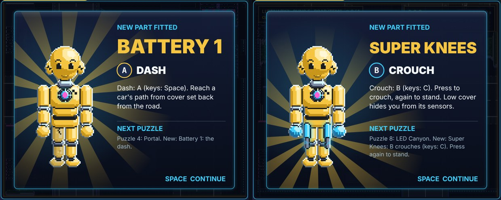

# DUMMIES GDD — Edit 122: Shipping V1, the part gift screen

**11 November 2026 · Lawrence Lek.** Builds Edit 121. Governs Shipping V1 (`p11/`, was Prototype 11.5). Newest wins.

- **Request (02:40):** "All the parts starting from Dash no longer show the nice animated screen with the new Dummy upgrade. Fix this!"
- **Name:** Prototype 11 is now **Shipping V1**: build label `SHIPPING V1 · PUZZLES`, page title, README, handover. URL stays `/p11/`.

## 122.1 Parts land on the chassis

- **Was:** a part earned at a clear showed a text card (`drawPartCard`). Prototype 9's gift screen was off in the puzzles since P11.0 (`gift: None`, Edit 113).
- **Now:** the clear shows Prototype 9's gift screen (Edit 84): the chassis lit, the drone lowers the module, flash, rings, rays, fanfare.
- **Texts:** P11 pad layout. Name; button and verb; what it does; NEXT PUZZLE with the next puzzle's new thing.

| Puzzle | Part | Button · verb | Module on the chassis |
|---|---|---|---|
| C1 High Road | Battery 1 | A · DASH | Chest battery (`battery1`) |
| B2 CCTV | Hands 1 | Y · CONES | Hands (`hands1`) |
| A3 The Stacks | Super Knees | B · CROUCH | Legs (`legs1`); Super Knees has no Prototype 9 module |

- **Flow:** stars → gift screen → Enter or A (after `ui.gift.fallSeconds` + `ui.gift.holdSeconds`) → next puzzle card.
- **Fit:** a long name shrinks to the panel; the next line wraps to three lines.
- **Text fix:** Super Knees' key reads "B (keys: C)"; crouch is a toggle (Edit 120).

## 122.2 Fixed on the way: the red car's entry speed

- **Bug (Edit 120):** a comment in `engine/duel.js` swallowed `c.cruise = P['vehicles.sedan.cruiseSpeed']; c.v = c.cruise;`. Since P11.4 the learner entered from a standstill.
- **Now:** it enters at cruise again, as designed (P11.3). B3 clears in 5 s ★★★ again (P11.5: 36 s ★··).
- **Submission 7's build (`index.html`):** untouched. Its last build predates the bug.

## 122.3 Tests

| Test | Result |
|---|---|
| Full runthrough (`qa/runthrough.js`) | Pass: nine puzzles first try, three gift screens (C1, B2, A3), Certification, Arcade. 5 min 59 s; no page errors ([video](p11_runthrough.mp4)) |
| `engine/p11_test.js --boss 200` | Certified: 3 hits, rung 7, 2 lessons; no errors |
| Gift screens, forced (A3, B2) | Name fits; Enter goes on; no page errors |

## 122.4 Files

- `engine/p11.js`: `P11.giftInfo`; the clear's part → phase `gift`; `continueGift` → the next puzzle.
- `engine/build_p9.py`: gift screen texts from `P11.giftInfo` (P11 build only); Super Knees key; Shipping V1 label and title.
- `engine/duel.js`: the red car's entry speed restored.
- `qa/runthrough.js`: the gift screen's shots (`p_<tile>_gift*`).
