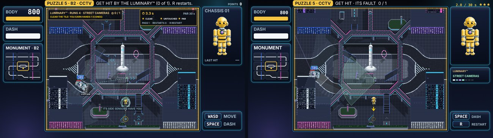
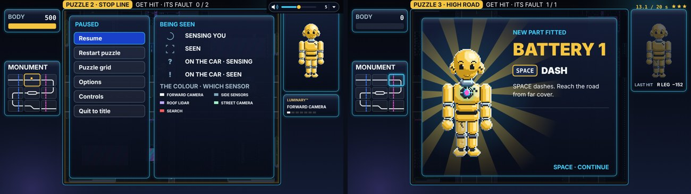

# DUMMIES GDD — Edit 123: FINAL V2, the UI cleanup

**11 November 2026 · Lawrence Lek.** Builds Edit 122. Governs FINAL V2 (`final_v2/`). Shipping V1 frozen at `p11/`. Newest wins.

- **Request (03:10):** "Create an adversarial UI agent to clean up the screen interfaces. There are too many text boxes, some are more like almost debug text, many superfluous messages onscreen now, create a new FINAL V2 build with more concise messages. Also the 'dash' helper (line and circle pointing outwards) stays visible when the drone is picked up which looks ridiculous. It should only be on when the dummy is on the ground, and can dash. Also, the CCTV camera is not quite clear how the player is spotted. Having the line is cool but actually shouldn't it be like a cone of vision, like for the cars? The UI agent should also create regular language for all the different UI visualisations of 'being seen'. Also, the 'up arrows' for the staircases are just too visible now. The gaps in the railings need to be a bit more clear. There can be a subtle arrow here, for where to jump down. Also, the first two screens are just too easy now. The dummy needs to land TWO hits successfully on the target car in the first two screens."

## 123.1 The agent

| Round | The UI cleanup agent (`pipeline/agents/ui_cleaner.md`, opus) | Result | Cost |
|---|---|---|---|
| 1 Spec | 40 screenshots of Shipping V1; every text the canvas drew (170), by shot | Cuts and rewrites for every text; one grammar for being seen; the camera's cone; the dash guide; stairs and gaps; 20 checks | $1.38 |
| 2 Review | The same screens of FINAL V2 | 15 findings. Blocker: no cone at B2 | $1.17 |
| 3 Review | The same, after fixes | 18 of 20 checks pass; 15 findings, the majors fixed | $1.16 |

- **Tools:** `python3 pipeline/ui_cleanup.py spec|review`; shots and text inventory: `engine/ui_cleanup_shots.js` (records every `fillText` per frame).
- **Kept against the agent:** the upgrade screen's model line (SED-01-001 · LUMINARY™ · AMBASSADOR) and the part names (OUTLOOK … LIMELIGHT). Both are the user's (Edits 120–121).

## 123.2 The screen: one fact, one place

| Region | Shipping V1 | FINAL V2 |
|---|---|---|
| Top bar | PUZZLE 5 · B2 · CCTV · GET HIT BY THE LUMINARY™ (0 of 1). R restarts. Drop: OBJECTIVE · B2, Write off a body… | PUZZLE 5 · CCTV · GET HIT · ITS FAULT 0 / 1. The same in the drop |
| Top right | POINTS 0 | 3.4 / 30 s and three star pips, dimmed once lost |
| Field, top left | LUMINARY™ · RUNG 4 · STREET CAMERAS ◎ 0 / 1; CLEAR THE TILE: YOU EARN… | Cut. The car block moves to the right column |
| Field, top right | Timer, PAR, CLEAR · UNTOUCHED · PAR, PASS · RESTARTS · R RESTART | Cut. Time and stars top right; R in the keys |
| Right column | CHASSIS 01, LAST HIT —, keys | The doll; LAST HIT after the first hit; the car block (LUMINARY™, its top sensor in that sensor's colour, seven pips); keys |
| Keys | WASD MOVE, SPACE DASH … | Fitted parts only. WASD on puzzles 1–2. R RESTART last |
| Left column | BODY 800 (36 px), DASH NOT FITTED, MONUMENT · B2 · DRONE | BODY (24 px); DASH once Battery 1 is fitted; MONUMENT |
| World labels | STOPS HERE, LINKED, #n, MOVE ALONG · DRONE IN n | Cut, cut, cut, DRONE IN n |
| Captions | IT BRAKES FOR YOU, ITS SIDE SENSORS HAVE YOU, LESSON DUE… | SEEN · <SENSOR>, once per sensor per attempt; IT STOPPED; YOUR FAULT |
| Card | Tile A1. Puzzle 1 of 9. Three-line tale. NEW … · PAR | Title, a two-line tale, the goal, NEW · …, EARN · …, PAR on its own line; SPACE · START steady |
| Gift | Dash: A (keys: Space)… NEXT PUZZLE … | The key of the device in use as a chip; one line; SPACE · CONTINUE |
| Result | TIME · PUZZLE CLOCK · RESTARTS · PASSES | The time; BEST when it differs; NEXT · <NAME>; SPACE · NEXT |
| Pause | Show trace; build and registry line; old cue key | No trace, no build line; the cue key is the seen grammar |
| Title, menus | …get hit, in combos, and earn your parts. 3 save slots… | Self-driving cars never hit anyone. Your job: get hit. No storage notes |

- **Keys by device:** card, gift and grid texts take the device in use (`P11.key`: SPACE/A, C/B, E/Y).
- **Gone from the dummy:** the charge ring and the reach tick (the DASH box and the dash guide carry them). The facing arrow is yellow.

## 123.3 Being seen: one grammar

| State | Field (the sensor's colour) | On the dummy | On the car's plate | Words |
|---|---|---|---|---|
| Idle | Fill 10%; dashed edge | — | — | — |
| Sensing | Fill 20% | An arc that fills over the notice time | ? | — |
| Seen | Fill 25%; solid edge | Four corner brackets | ! | SEEN · <SENSOR>, first time per attempt |
| Lost | Red searchlight; LAST SEEN ring | — | ? red | LAST SEEN |

| Sensor | Colour | Field |
|---|---|---|
| Forward camera | #f4f8fa | Ribbon along its lane; too-late zone; stop bar. No pulses |
| Side sensors | #7fa8bc | Two fans, solid edges. No grade rings, no pings |
| Roof lidar | #c3a6ff | Sweep and reach; quieter returns. Brackets when the sweep crosses you on a deck (0.6 s) |
| Street camera | #9ff2c8 | A cone. Seen: brighter; dashed line you → post, solid post → car |
| Road items | #ff8a1f | Brackets on cones in its lane |
| Crash memory | #ff5a5a | Chalk and rings; no numbers |

- **Several at once:** the highest rung marks the dummy; the lower fields only brighten.
- **Plates:** the learner's only. No plate on white cars, ghosts or gone cars; no honk "!".

## 123.4 The camera's cone

| Puzzle | Stage | Was | Now |
|---|---|---|---|
| B2 CCTV | 10.5 | `perception.streetCameraFov` 360, no range (sees anywhere) | 90°, `perception.streetCameraPanArc` 0, `perception.streetCameraRange` 180 |
| A3 The Stacks | 10.6 | 360°, range 180 | 90°, pan 0 |
| C3 Certification | 10.8 | 60°, panning | Unchanged |

- **Drawn above the decks:** cones, gap marks, the dummy's mark and captions draw in a late pass. At B2 the plaza had covered the cone.
- **Solutions:** B2 and A3 still clear ★★★.

## 123.5 The dash guide, stairs, gaps

- **Dash guide:** only in play, on the ground (move, idle, coast), with a full charge. Never on the drone, in a drop, mid-dash or in the air. Circle r 9, 70%; HIT or FAULT.
- **Stairs:** no cyan corner boxes; one grey chevron per apron (`world6.js` V2 patch).
- **Parapet gaps:** yellow caps 4 × 10 at the gap's ends, on its open side; a faint line across the opening. On the deck within 120 of the gap: a double yellow chevron out over the parapet, pulsing.

## 123.6 Two hits on the first two puzzles

| Puzzle | Hits | Par | Solution (headless) |
|---|---|---|---|
| A1 First Contact | 1 → 2 | 10 → 25 s | 20.4 s ★★★ |
| B1 Stop Line | 1 → 2 | 15 → 18 s | 13.4 s ★★★ |

- **No lesson between hits:** only the boss teaches mid-puzzle (`boss: true`, C3). A1 and B1 learn at the clear, as before.

## 123.7 Tests

| Test | Result |
|---|---|
| Headless solutions, eight puzzles | All ★★★ |
| `engine/p11_test.js --boss 200` | Certified in 77 s: 3 hits, rung 7, 2 lessons; no errors |
| Full runthrough (`qa/runthrough.js`) | Pass: nine puzzles first try, three gift screens, Certification, Arcade. 5 min 27 s; no page errors ([video](final_v2_runthrough.mp4)) |
| The agent's checks (round 3) | 18 of 20; the two misses fixed after (camera report lines; gap caps 4 × 10 and the arrow, seen in the runthrough's C1) |

## 123.8 Files

- `pipeline/agents/ui_cleaner.md`, `pipeline/ui_cleanup.py`, `pipeline/inputs/ui_cleanup_context.md`, `engine/ui_cleanup_shots.js`.
- `engine/duel_ui.js`: the seen grammar (`v2Who`, `v2Mark`), the late pass (`v2Late`), gaps (`v2Gaps`), the car block (`v2Car`), captions, labels, the dash guide.
- `engine/p11_ui.js`: no attempt panel; result and grid texts. `engine/p11.js`: objective, card, gift texts; `P11.key`; the boss flag.
- `engine/build_p9.py`: `v2_game_js` (top right, keys, columns, card, gift, pause, cue key, menus, plates, the dummy's ring and arrow); the stairs (`world6_js(v2)`); output `final_v2/`.
- `content/puzzles_map1.json`: A1, B1 two hits; tales; `newLine`; camera values; `boss`.
