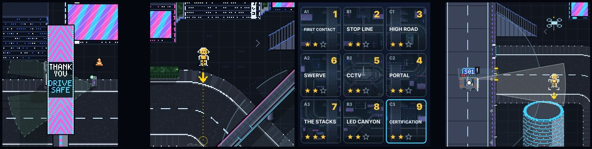

# DUMMIES GDD — Edit 124: FINAL V2.1, the playtest fixes

**12 November 2026 · Lawrence Lek.** Builds Edit 123. Governs FINAL V2 (`final_v2/`, same link). Shipping V1 frozen at `p11/`. Newest wins.

- **Source:** Lawrence's phone playtest of FINAL V2, 17 annotated screenshots (11 Nov, 21:53). Answers (12 Nov, 00:17): the drop is accidental; one lesson in the boss; build Map 2 (Edit 125); the bending thing is the headlights: lose them.

## 124.1 Sensors and cameras

| Note | Cause | Fix |
|---|---|---|
| Headlights bend with the road (Portal, LED Canyon) | The red car's lane band followed the road; white cars kept headlight beams | No lane band, no headlight beams on any car (brake glow stays). The forward field is one straight cone from the nose (before the cone: a straight beam). Idle 8% and dashed; seen 20% and solid |
| Side sensors: close and far (High Road, Portal) | The sim grades each side in two (`perception.sideGrades` 2); V2 cut the rings | Each fan in two bands: CLOSE (inner grade, brighter; it notices fast, slows hard), FAR. A dashed arc between |
| CCTV static (CCTV, The Stacks) | V2 set `perception.streetCameraPanArc` 0 | B2, A3: Fov 90, `PanArc` 90, `PanSeconds` 3, `PanHold` 1, `Range` 180, `Height` 60 |
| CCTV sees through the world (CCTV) | The camera checked low cover only | `perception.streetCameraOccluded` 1 (proposed): buildings, the monument, tall cover and a deck overhead block it. The drawn cone casts the same shadows |
| CCTV wrong language (The Stacks) | A flat mint wedge, solid edges | The cars' field grammar in the camera's colour: idle 10% and dashed; seen 25% and solid |
| The camera no longer mattered | Its auto post stood beside the hiding spot, facing away | Posts set by hand (`camera.at`): B2 [510, 360, 165], A3 [360, 190, 0]. They watch the hiding side 81% / 91% of a sweep. Hiding with the post up fails; breaking it clears ★★★ |

## 124.2 The dummy

| Note | Fix |
|---|---|
| Crouch not visible (LED Canyon) | Crouched sprite: legs folded to 30%, torso to 70%, knees out. Touch B reads STAND while crouched |
| Moves too slowly (Certification) | `movement.duckSpeedFactor` 0.35 → 0.6. `proto.parts.legSpeedFloor` 0.5 → 0.8; `torsoTurnFloor` 0.8. `legDashLoss` 0: wear never shortens the dash |
| Body doesn't go down (First Contact) | No patch after contact: damage stays for the puzzle. A new attempt brings a fresh body. Worn out short of the goal: wrecked; the drone drops a fresh body at the start; hits, car and clock carry on; not untouched. BODY after the clear shows what is left, not 0 |
| More juice on a hit (Certification) | `feedback.hitStop` 0.06 → 0.14. A learner hit: kick 16 for 0.6 s, white flash 0.24 s, 14 debris, 20 sparks, a ring. The big-hit sound on every learner hit |
| Chalk over buildings (First Contact) | The chalk is a lying dummy's outline in the ground's pixels (55%; 28% once forgotten), under buildings and decks. No vector chalk |
| Wrong drone on a pick-up (Portal) | The block lift flies the drop-in's pixel drone on a cable |

## 124.3 The world and the screens

| Note | Fix |
|---|---|
| Fall through the railing gap by accident (Certification) | Brushing along a parapet: the push through a gap must be held 0.35 s (`world.gapDropHold`, proposed). Straight out through a deck's gap (60% of the step across it), a dash or a jump: at once |
| Gateway sign sideways (Certification) | THANK / YOU / DRIVE / SAFE, one word a row, read left to right; beam 29 px |
| Model line (upgrade screen) | Cut (SED-01-001 · LUMINARY™ · AMBASSADOR) |
| Touch buttons too big (The Stacks) | Default face keys ×0.8 (was ×1.15), stick ×0.9. The pencil still resizes |
| Save screen | Header STORY; title STORY MODE; a slot on one line: MONUMENT · PUZZLE 6 · ★ 12. No second line; no touch hint |
| Grid: visual map when done | A solved puzzle's cell shows its tile, dimmed under a gradient |
| What is PAR? | ★★★ UNDER 60 s (grid, card). The result's third star: UNDER 60 s |
| Two upgrades in one map (Certification) | One lesson: Certification starts at rung 6, learns SEARCH after hit 1. AUDIT TRAIL (crash memory) moves to LED Canyon's clear (B3 5 → 6; it learned nothing before) |

## 124.4 Tests

| Test | Result |
|---|---|
| Headless solutions, eight puzzles | All ★★★ (B2 and A3 scripts break the new posts) |
| B2, A3 without breaking the post | Fail in 60 s, as designed |
| `engine/p11_test.js --boss 200` | Certified in 97 s: 3 hits, rung 7, 1 lesson; no errors |
| Full runthrough (`qa/runthrough.js`) | Pass: nine puzzles first try, Certification, the Map 1 celebration, Arcade. 6 min 24 s; no page errors ([video](final_v21_runthrough.mp4)) |
| Browser pad runs (`qa/attack.js`), C1, C2, A3, B2 | All clear. B2's script now waits for a fresh car after breaking the post |

## 124.5 Files

- `engine/duel_ui.js`: `beam`, `crossStraight`, the forward cone, side bands, `camField`, `liftDrone`; no vector chalk or model line in P11.
- `engine/duel.js`: `seeingCamera`, `camUnderDeck`, `camWall`.
- `engine/p11.js`: no patch; `p11Fresh`; `p11CameraAt`; `slotLine`; ★★★ UNDER.
- `engine/p11_ui.js`: grid thumbnails; UNDER labels.
- `engine/build_p9.py`: `v21_game_js` (headlights, crouch sprite, STAND, touch size, juice, chalk, BODY, saves, thumbnails); world6 V2.1 (gateway, gap hold); sim and plan params.
- `content/puzzles_map1.json`: B2/A3 cameras; B3 top rung 6; C3 start rung 6, card text.
- `qa/solutions/B2.json`, `A3.json`: the new posts.
