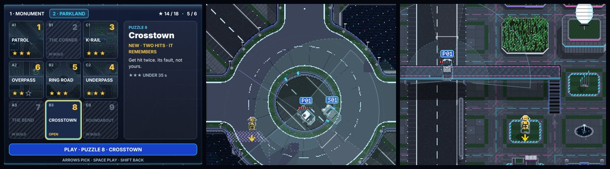

# DUMMIES GDD — Edit 125: Map 2, Parkland

**12 November 2026 · Lawrence Lek.** Builds Edit 124. Governs FINAL V2 (`final_v2/`). Newest wins.

- **Request (00:17):** "Build Map 2's puzzles, with the second vehicle, and the trained Luminary should also be on the road."
- **Status:** six puzzles built and tested; three in build (124.4).

## 125.1 The map

| Item | Map 2 |
|---|---|
| District | Parkland (`content/puzzles_map2.json`, `map.district` parkland) |
| Learner | VANGUARD™ POL-01-001, plate P01, police (Edit 121 livery and part names) |
| On the road | LUMINARY™ SED-01-001, plate S01: the car you certified, a white car with every sensor |
| Opens | When Map 1 is certified. Map 1's grid plays a celebration, then opens Parkland |
| Kit | Battery 1, Hands 1, Super Knees; Legs 1 earned at puzzle 1 |
| Ladder | Rung 2 → 6 over the map (EYEWITNESS, OUTRIDERS from the factory; WATCHTOWER, INFORMANT, CORDON, CASEFILE learned) |

## 125.2 The senior Luminary™

- **Spawn:** `duel.senior` (proposed): the lane it drives. `duel.seniorDelay`, `duel.seniorReturnSeconds`, `duel.seniorSpeed`. One at a time.
- **Driving:** a white car. It brakes for you. A touch is your fault.
- **Eye:** all round (`duel.seniorFov` 360), `duel.seniorRange` 220, stopped by buildings and decks like a camera.
- **Report:** from the learner's rung 4 (INFORMANT), a sighting is a street-camera sighting. The learner sees you behind cover and notices you at once (`expected()`).
- **Drawn:** its ring in mint once it reports, faint white before. Link: dashed you → S01, solid S01 → P01. Caption SEEN · LUMINARY™.

## 125.3 The puzzles

| n | Tile | Name | Rungs | New | Hits | Solution (headless) | Par |
|---|---|---|---|---|---|---|---|
| 1 | A1 | Patrol | 2 | The Vanguard™: forward camera and side sensors. Earns Legs 1 | 1 | Open ground 148 off its lane; dash at nose 54. 4.0 s ★★★ | 20 |
| 2 | B1 | The Corner | — | In build | — | — | — |
| 3 | C1 | K-Rail | 2 → 3 | Jump: a running jump clears a K-rail | 1 | Run 0.9 s at the rail, jump, land in its lane; nose 210. 14.3 s ★★★ | 25 |
| 4 | C2 | Underpass | 3 → 4 | Lidar: it sees you up on the deck | 1 | Under the deck, 150 off; dash at nose 55. 11.0 s ★★★ | 20 |
| 5 | B2 | Ring Road | 4 → 5 | The Luminary™ reports you | 1 | Out of its ring, 150 off; dash at nose 52. 7.6 s ★★★ | 20 |
| 6 | A2 | Overpass | 5 → 6 | Cones stop it. Two hits | 2 | 150 west; dash at nose 62, twice. 19.9 s ★★★ | 30 |
| 7 | A3 | The Bend | — | In build | — | — | — |
| 8 | B3 | Crosstown | 6 | It remembers every crash. Two hits; the Luminary™ follows it | 2 | North, across the empty lane; dash at nose 58, twice. 22.2 s ★★★ | 35 |
| 9 | C3 | Roundabout | — | In build | — | — | — |

- **Certified:** at the last built puzzle (B3). Map 2's celebration counts built puzzles only.

## 125.4 In build

| Tile | Why |
|---|---|
| B1 | Its ground road clips the corner: 160 of the tile. A red-car route needs 360. The puzzle wants a deck duel |
| A3 | No open-ground or cover solution passed at rungs 5–6 in the time (garden beds block most lines) |
| C3 | The boss: three hits at rungs 6–7 found no tested solution yet |

## 125.5 Rules changed

| Rule | Value |
|---|---|
| `abilities.legs.airtimeBase` | 0.3 → 0.85 s. At P11's 70% run speed, 0.3 s fell short of a K-rail |
| `upgrades.jumpHeight` | 44 → 60: a wider take-off window |
| A laid-out K-rail | Jumpable (`zTop` = `world.jumpableHeight`) |

## 125.6 Screens

- **Grid:** map tabs (1 · MONUMENT, 2 · PARKLAND · LOCKED). Up from the top row reaches them; left and right switch. Tap works.
- **Celebration:** MAP CERTIFIED, the built puzzles light one by one, the stars count up, the next map and its car. Any key opens it.
- **Save line:** PARKLAND · PUZZLE 5 · ★ 41 (stars across maps).
- **Result:** the last built puzzle: MONUMENT CERTIFIED · PARKLAND IS OPEN.

## 125.7 Tests

| Test | Result |
|---|---|
| Headless, Map 2's six solutions | All ★★★ |
| Browser pad (`qa/attack.js`), Map 2's six | All clear |
| Map 1 runthrough after Map 2 (`qa/runthrough.js`) | Pass: nine puzzles first try, Certification (one mid lesson), the celebration, Arcade. 5 min 7 s; no page errors |

## 125.8 Files

- `content/puzzles_map2.json`; `qa/solutions/parkland_*.json` (tile `parkland:A1`).
- `engine/p11.js`: maps (`MAPS`, `useMap`, `setMap`, `mapOpen`), records per map, celebration flag, `lastOf`.
- `engine/p11_ui.js`: tabs, celebration, built counts.
- `engine/duel.js`: plans by district (`STORY_MAPS`); `admitSenior`, `seniorSees`, `expected`; Parkland cover family; jumpable K-rails.
- `engine/duel_ui.js`: liveries per class; the senior's ring and link; SEEN · LUMINARY™.
- `engine/build_p9.py`: Map 2 plan, story and traffic; senior sprite and plate; the grid backdrop by map; Legs 1 airtime and height.
- `qa/headless.js`, `engine/p11_goto.js`: `parkland:` tiles.
