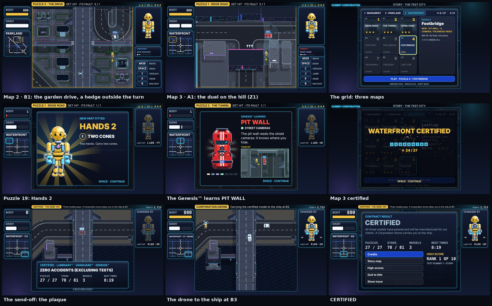

# DUMMIES GDD — Edit 126: Map 2 finished, Map 3 Waterfront, upgrades over 27, the send-off

**12 November 2026 · Lawrence Lek.** Builds Edit 125. Governs FINAL V2 (`final_v2/`). Newest wins.

- **Request (03:06):** "wait, have you built all the puzzles? if not adapt the map so it fits, and then build map 3 with the final nine tiles. Maybe the dummy upgrades can be spaced out, since now there are 27 levels? And also remember the final 'send off' with certification."
- **Status:** 27 puzzles built and tested. Map 2's last three fit after one world change (126.1). Map 3 on all nine Waterfront tiles; two are hilltops (126.3). Eight upgrades over 27 puzzles (126.4). The send-off after Map 3 (126.5).

## 126.1 Map 2: the last three puzzles

| Tile | Problem (Edit 125) | Fix |
|---|---|---|
| B1 | The boulevard clips the corner: 160 of the tile. A route needs 360 | **The map adapted.** A garden drive, B1's own road (`tile: 'B1'` in world6, proposed). In from the north edge east of the highway, a U-turn north of the walkway, back out north. No other tile draws it: no seam. The garden rebuilds round it |
| A3 | No open-ground line passed at rungs 5–6 | Route 1, out of the bend. One hit, not two (B3 keeps the two-hit memory puzzle). Earns Battery 2 |
| C3 | No tested boss | Route 8: in on the SE arm, round the north of the ring, out west. Three spots, scripted |

| n | Tile | Name | Rungs | New | Hits | Solution (headless) | Par |
|---|---|---|---|---|---|---|---|
| 2 | B1 | The Drive | 2 | On a bend it looks along the curve. Earns Legs 1 | 1 | Behind a hedge 90 off the kerb, outside the turn; dash north at nose 55–70. 17 s ★★★ | 20 |
| 7 | A3 | The Bend | 6 | Out of the bend it is fast. Earns Battery 2 | 1 | 150 south where the bend ends; dash north at nose 55–75. 11 s ★★★ | 20 |
| 9 | C3 | Roundabout | 6 → 7 | The boss: learns SEARCH after hit 1 | 3 | East of the SE arm; north of the ring; the SE arm further in; three tries a spot. 60 s ★★★ | 75 |

- **A1 Patrol:** earns nothing now. Legs 1 moves to B1 (126.4).
- **Certified:** at C3. Map 2's celebration opens Map 3.

## 126.2 The hill duel

- **Why:** Waterfront A1 and C1 are hilltops. Their only road is the ridge road at Z1. No Z0 lane.
- **Rule:** a tile with no Z0 road duels on the hill's streets (`sc.hillSim`, `elev0` 1).
- **Levels:** every duel check reads the body's level against the duel's floor, not against 0. Hits use Prototype 9's own `meets`.
- **Sightlines:** the hill's buildings (`solidsZ`, z 1) stop the sensors and the Vanguard™'s eye.
- **Drop:** `layout.drop` takes `[x, y, level, floor]`: `[200, 330, 1, 0]` on A1.
- **Drawn:** the fields, the kit and the marks lift with the hill (the hill layer's `lift`).
- **Not on the hill:** cover pieces, camera posts and cones. Each paints into the Z0 art, under the hill.

## 126.3 Map 3: Waterfront

| Item | Map 3 |
|---|---|
| District | Waterfront (`content/puzzles_map3.json`) |
| Learner | GENESIS™ SPT-01-001, plate R01, the racing car (Edit 121 livery and part names) |
| On the road | VANGUARD™ POL-01-001, plate P01: the car you certified on Map 2. It reports from the Genesis™'s rung 4 |
| Opens | When Map 2 is certified |
| Ladder | Rung 3 → 7 (RACING LINE, SPOTTER, BLIMP from the factory; PIT WALL, YELLOW FLAG, PACE NOTES, RECON LAP learned) |

| n | Tile | Name | Rungs | New | Hits | Solution (headless) | Par |
|---|---|---|---|---|---|---|---|
| 1 | A1 | Ridge Road | 3 | The Genesis™, on the hill. Earns Hands 2 | 1 | The alley east of the portal block; dash north at nose 45–75. 14 s ★★★ | 25 |
| 2 | B1 | The Tunnel | 3 → 4 | It comes out of the tunnel fast. The cove is narrow | 1 | North of the west stair, 110 off its lane; a slanted dash (47°) at nose 75–90 lands ahead of it. 24 s ★★★ | 25 |
| 3 | C1 | Upper Town | 4 | PIT WALL: the Vanguard™ reports you | 1 | The west alley; skip the pass the Vanguard™ shares; dash north at nose 60–75. 45 s ★★★ | 50 |
| 4 | C2 | Footbridge | 4 → 5 | A street camera watches the beach. The bridge hides you | 1 | Under the east bridge; dash north at nose 60. Or break the post. 16 s ★★★ | 25 |
| 5 | B2 | The Circus | 5 | YELLOW FLAG: cones stop it. Earns Legs 2 | 1 | The beach park south of the west avenue; dash north at nose 60. 15 s ★★★ | 30 |
| 6 | A2 | The Cliff | 5 → 6 | Two hits. The Vanguard™ drives the other way | 2 | Under the west bridge, then the east beach. 25 s ★★★ | 35 |
| 7 | A3 | The Seawall | 6 | PACE NOTES. Earns Battery 3 | 1 | On the sand north of the drive; dash south at nose 60. 14 s ★★★ | 25 |
| 8 | B3 | The Quay | 6 | Two hits, two places. The ship is moored here | 2 | North of the drive, either side of the beach road. 23 s ★★★ | 40 |
| 9 | C3 | Last Lap | 6 → 7 | The boss: learns RECON LAP after hit 1 | 3 | The cut-in bot (`qa/bot.js`): 60 s headless; 98 s in the browser | 75 |

## 126.4 Upgrades over 27 puzzles

- **Rule:** one part every 2–5 puzzles. A puzzle earns a part or teaches the car, never both.

| n | Map · tile | Part | Does | Registry |
|---|---|---|---|---|
| 3 | 1 · C1 High Road | Battery 1 | Dash | `battery1` |
| 5 | 1 · B2 CCTV | Hands 1 | Cones | `hands1` |
| 7 | 1 · A3 The Stacks | Super Knees | Crouch | `knees1` |
| 11 | 2 · B1 The Drive | Legs 1 | Jump (was 2 · A1) | `legs1` |
| 16 | 2 · A3 The Bend | Battery 2 | Two charges (`battery.capacity` 2) | `battery2` (new) |
| 19 | 3 · A1 Ridge Road | Hands 2 | Two cones (`abilities.hands.conesPerLevel` × 2) | `hands2` (new) |
| 23 | 3 · B2 The Circus | Legs 2 | Longer airtime (+`abilities.legs.airtimeStep` 0.1 s) | `legs2` (new) |
| 25 | 3 · A3 The Seawall | Battery 3 | Faster recharge (`abilities.battery.level3Seconds`) | `battery3` (new) |

- **Gift screen:** Prototype 9's module art for each tier (`DOLL_MODS`). Texts in the P11 pad layout.
- **Kits:** each puzzle's `kit` lists every part earned before it.

## 126.5 The send-off

- **When:** Map 3's first certification. Enter on the result card.
- **Plaque:** Prototype 9's unveiling (Edit 94). Header CERTIFIED · LUMINARY™ · VANGUARD™ · GENESIS™. ZERO ACCIDENTS (EXCLUDING TESTS). PUZZLES, STARS, MODELS, BEST TIMES.
- **Voyage:** A goes on. A Corporation drone lifts the dummy over the edge to Waterfront B3 and sets it on the container ship.
- **Ending:** CERTIFIED. "All three models have passed and will be manufactured for our clients. A Corporation drone carries you to the ship." The plaque's numbers. Credits, Story map.
- **No duel** on the tiles it flies over (`p11Finale`).

## 126.6 Screens

| Item | Change |
|---|---|
| Grid tabs | 1 · MONUMENT, 2 · PARKLAND, 3 · WATERFRONT. A locked tab reads CERTIFY <the map before> TO OPEN <map> |
| Plates | From the map: R01 for SPT-01-001 (not a fleet model), P01 for the Vanguard™ as senior |
| Senior | Sprite, plate and caption from the map: SEEN · VANGUARD™ on Map 3 |

## 126.7 Tests

| Test | Result |
|---|---|
| Headless, every Map 2 and Map 3 solution (`qa/solutions/parkland_*`, `waterfront_*`) | All clear. Bosses: Map 2 scripted, Map 3 by the cut-in bot |
| Headless, Map 1's eight scripts (after the world change) | All ★★★ |
| Browser pad (`qa/attack.js`), the 12 new puzzles | All clear |
| Browser cut-in bot, Map 3 boss | Certified in 98 s; 3 hits, 1 lesson; no errors |
| Map 3 in order in the browser, then the send-off (real inputs from a save with Maps 1–2 certified) | Pass: nine puzzles first try, three gift screens, three lessons, the plaque, the voyage to B3, CERTIFIED, the grid's celebration. 5 min 41 s; no page errors |
| Map 2 C1 K-Rail, browser | The timed run-up failed in long runs (the pad's clock is real time). The script now jumps at a take-off point (x 275): window nose 215–245; 4 of 4 browser runs clear |
| Bug found and fixed | Clearing any Map 3 puzzle played Prototype 9's own finale (the last district's last tile). `PuzzleSim.checkTerminal` cancels it; only Map 3's certification plays the send-off |
| Map 2 in order in the browser (real inputs from a save with Map 1 certified) | Pass: nine puzzles, the boss first try (57 s ★★★), the celebration. B3's script took three attempts. 11 min 53 s; no page errors |
| Full runthrough (`qa/runthrough.js --all`), three runs | Map 1: nine puzzles first try, every run. Run 1 found the finale bug (Map 3 A1); runs 2–3 stopped on Map 2 scripts (C1, then B3) that miss under the recorder's load. Both scripts fixed above; the run in order (rows above) passes |
| Map 2 B3, browser | The same spot twice missed often (it remembers the crash and slows there). Now two spots, x 640 then x 240, as a pair that repeats: 3 of 4 runs clear alone |

## 126.8 Files

- `content/puzzles_map2.json` (B1, A3, C3 built; Legs 1 to B1; Battery 2 at A3); `content/puzzles_map3.json` (new).
- `engine/build_p9.py`: maps from `puzzles_map{2,3}.json`; B1's drive (world6 V2.1); parts; plaque, ending, plates; the patched world written for headless runs (`engine/.cache/world6_p11.js`).
- `engine/duel.js`: the hill duel (`elev0`, `duelZ0`); the map's senior model; no duel in the send-off.
- `engine/duel_ui.js`: `hillLift`; the senior's class and name from the map.
- `engine/p11.js`: drops with a level; `tagOf`; the send-off (`p11Final`, `p11SendOff`); gifts for the new parts.
- `engine/p11_ui.js`: the locked tab's line. `engine/p11_goto.js`: Map 3 saves. `engine/progression.json`: four parts.
- `qa/bot.js` (new): the cut-in bot headless. `qa/headless.js`: three maps; the page's world. `qa/runthrough.js`: `--all`.
