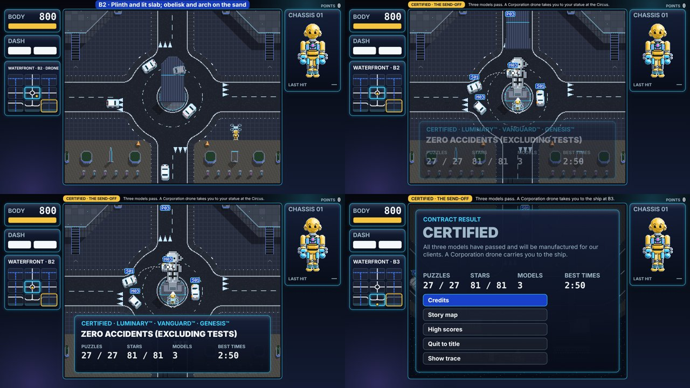
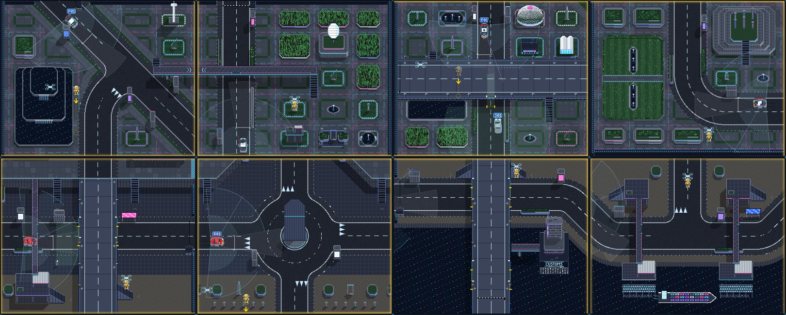

# DUMMIES GDD — Edit 127: FINAL V3. Ledges, square openings, the statue, street furniture

**12 November 2026 · Lawrence Lek.** Builds on Edit 126. Governs FINAL V3 (`final_v3/`). FINAL V2 is frozen at `final_v2/`. The newest edit wins.

- **Requests (17:10–18:02):**
  - "Now I can't jump down from the ledges?"
  - "In the first map at B2, the character cannot jump down from the elevated walkways … (rule: you can't put diagonal openings in the walkway)"
  - "For the Waterfront and Parkland there isn't enough street furniture."
  - "We also don't see the statue of the dummy being unveiled at the end."
- **Open:**
  - The ghost outline at Map 2's hint.
  - Waterfront Puzzle 3 "goes back to Puzzle 2".
  - Neither reproduces yet (127.6).

## 127.1 Ledges

| Floor | V2.1 (Edit 124) | V3 |
|---|---|---|
| Walkway opening | The deck guard applied here too. It never dropped unless you dashed or jumped | Drops at once, as before Edit 124. 0.22 s from the spine straight out |
| Parkland B2 ring, open edge | Same fault | Drops at once |
| Hill edge | Dropped (`f.drop`) | Unchanged |
| Deck parapet gap | A shallow push needed a 0.35 s hold. The hold reset on every push-back and never finished | A push at least 37° off the parapet drops (`world.gapDropShare` 0.6, proposed). A shallower one slides past. The hold (`world.gapDropHold`) is cut |
| A gap's far corner | Trapped a body that brushed into the gap | The body steps back inside the parapet line and slides on |

- **Rule:** the Edit 124 guard is for a deck's parapet gaps only.

## 127.2 Walkway openings

- **Rule:** an opening never sits on a diagonal or a corner.
- **Placement:** the opening and its run sit on a square stretch of the spine (half its width plus 4 each side), still over the road (`world.walkwayWidth`).
- **Fallback:** an opening that fails slides along the spine, up to a lane plus its own width. If no square stretch is in reach, the road has no opening.
- **Monument B2:** the four openings move off the octagon's diagonals onto its east and west runs: (554, 239), (554, 400), (246, 401), (246, 239).
- **All 27 tiles:** 10 walkway openings, all square.

## 127.3 The statue

- **Where:** the dummy monument stands at the Circus, Waterfront B2 (`world.dummyMonument`).
- **Covered:** the cloth (`world.monumentShroud`) stays on through all three maps until the send-off.
- **Send-off order:**
  1. Map 3's certification.
  2. A Corporation drone lifts the dummy at C3. It flies one tile at a time, rows first, then columns: north to C2, then west to B2.
  3. It sets the dummy down on the paving, in front of the cloth (cx, cy + 40).
  4. The cloth lifts over `ui.finale.unveilSeconds` (1.2 s). The plaque fades in.
  5. A goes on: the drone carries the dummy south to the ship at B3. Then CERTIFIED.
- **Lines:**
  - Send-off line: "… takes you to your statue at the Circus." After the unveiling: "… to the ship at B3."
  - Drone caption: "Carrying the certified model to its statue at the Circus."
- **Gate:** `window.P11_V3`, set by the build. A V2 rebuild keeps Edit 126's send-off.

## 127.4 Street furniture

- **What:** Map 1's street furniture (kiosk, cabinet, hedge, planter, billboard), in each puzzle's `layout.cover`, marked `street: true`. All solid. Tall pieces hide a standing dummy; low pieces hide one that crouches.
- **Families:**
  - Parkland: hedge, kiosk, planter, cabinet.
  - Waterfront: kiosk, planter, cabinet, billboard (proposed `FAMILY.waterfront`).

**Placement rules (`qa/furnish.js`):**
- On the red route's kerbs, at least 36 from the screen's edge.
- Off every road's asphalt, roundabout rings included (road distance ≥ 50).
- Off water, decks, walkways and the hill.
- Tall pieces never south of a road running across.
- Clear of the solution's lines: the drop, each spot, each dash and the walks between them. 64 for tall pieces, 44 for low ones.
- 44 clear of cones and camera posts.
- Up to 4 a tile, 130 apart, kinds in turn.
- **Kept only if the solution still clears with the same stars.** On the bosses, the cut-in bot must still clear.

| Map | Pieces added | Per tile |
|---|---|---|
| 2 · Parkland | 30 | A1 4 · B1 0 · C1 4 · C2 4 · B2 4 · A2 4 · A3 4 · B3 3 · C3 2 |
| 3 · Waterfront | 20 | A1 0 · B1 1 · C1 0 · C2 4 · B2 2 · A2 4 · A3 3 · B3 4 · C3 2 |

- **Exceptions:**
  - Parkland B1: no room. The drive keeps its one hedge.
  - Waterfront A1, C1: hill duels. Cover would paint under the hill (126.2).
  - Bosses: the bot failed with tall pieces by Waterfront C3's north road, so those were left out.

## 127.5 Tests

| Test | Result |
|---|---|
| Ledges, headless (`qa/ledges.js`): 31 openings on 27 tiles | Problems: 0. Walkways drop 0.22–0.33 s, straight or 45°. Deck gaps drop straight (0.97 s from the centre line) and at 45° (1.22 s), and when hugging the parapet at 45° (0.70 s). 30° and a 15° brush slide past |
| Parkland B2 ring | Drops off the open edge in 0.43–0.50 s |
| Headless, all 27 solutions | All clear. Maps 2–3 with the furniture: unchanged times and stars. Map 1 C3 (boss script) ★☆☆ as in V2 |
| Browser pad (`qa/attack.js`), 17 Map 2–3 solutions on `final_v3` | 16 clear one at a time. At 4 in parallel, 8 cleared: pad timing under load. Parkland B3 misses in V3 and V2 alike (one hit in 90 s); headless ★★☆ |
| Browser pad, Map 1's eight scripts on `final_v3` (the walkway openings moved) | 8 of 8 clear, no findings |
| Send-off, browser | C3 → C2 → B2 under the cloth, the cloth lifts, the plaque, B2 → B3, CERTIFIED. No page errors |
| Waterfront Puzzle 2 → 3 → 4 in order, browser | B1 clears, lesson, C1's card. C1 clears (1:05), NEXT · FOOTBRIDGE. No return to B1 |

## 127.6 Open

| Note | What was checked | Need |
|---|---|---|
| Waterfront Puzzle 3 "goes back to Puzzle 2" | Order B1 → C1 → C2; C1 from the grid; six failed passes and hints; a wreck; walking off the hill each way (fenced on all four sides). The car runs west → east and leaves east | The moment: the card, mid-play, after the clear, or the car |
| Ghost outline at Map 2's hint | Hint-time shots of all nine Map 2 puzzles: no outline unless hit | Which outline: the x-ray checker, the white chalk, the red search ghost |

## 127.7 Files

- **`engine/build_p9.py`:**
  - `--v3` builds `final_v3/`.
  - The V3 world patches: decks only, the share rule, out of the corner, square openings.
  - `v3_game_js`: the drone's caption.
  - `window.P11_V3`.
- **`engine/p11.js`:** `p11Tour`, `p11Next`, `p11StatueSpot`, `stepVoyage`, `end`, `monumentShrouded`.
- **`engine/duel.js`:** the send-off line.
- **`content/puzzles_map2.json`, `puzzles_map3.json`:** 50 `street` pieces.
- **`qa/ledges.js` (new):** the ledge sweep.
- **`qa/furnish.js` (new):** the furniture placer.
