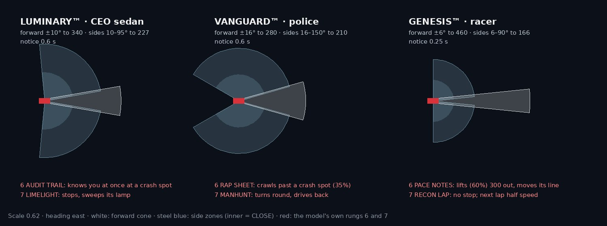
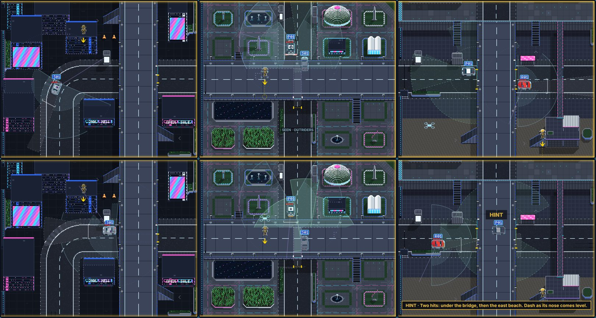

# DUMMIES GDD — Edit 128: FINAL V3.1. Three cars, three sensor suites

**13 November 2026 · Lawrence Lek.** Builds on Edit 127. Governs FINAL V3 (`final_v3/`, same link). The newest edit wins.

- **Request (12 Nov, 21:51):**
  - "There doesn't really seem to be any particular difference between the upgrades for the different vehicles."
  - "When Luminary appears in the Second Map (Parkland), it's like their sensors are quite generic? (no real difference between front and side)"
- **Cause:** the three models learned the same seven rungs with the same numbers. Only names and art differed. The senior saw a 220 ring all round (`duel.seniorFov` 360, `duel.seniorRange` 220).
- **Decision (Lawrence):** own sensor shapes and own signature rungs. The ladder's order stays, so each map still teaches in sequence.

## 128.1 The rule

- **Shape:** each model's hardware has its own shape and numbers.
- **Data:** `models.<cls>.<perception id>` overrides the 10.9 field for that model (proposed). Table: `MODELS` in `engine/duel.js`.
- **Order:** rung 1 forward camera, 2 side zones, 3 lidar, 4 street cameras, 5 road items, 6 memory, 7 search. Unchanged.
- **Own mechanics:** rungs 6 and 7 work differently per model (128.3).
- **Luminary:** keeps Prototype 10's field. Map 1 is unchanged.
- **Gate:** `window.P11_V3`. A V2 rebuild keeps one suite.

## 128.2 Field shapes

| Parameter | LUMINARY™ (CEO sedan) | VANGUARD™ (police) | GENESIS™ (racer) |
|---|---|---|---|
| `perception.forwardConeAngle` | ±10° | ±16°: wide dash-cam | ±6°: the racing line |
| `perception.coneRadius` (forward reach) | 340 | 280: short | 460: long |
| `perception.sideConeRatio` (side reach) | 0.667 (227) | 0.75 (210) | 0.36 (166): short spotters |
| Side zones, `sideConeAxis` ± `sideConeAngle` | 10–95° | 16–150°: outrider pods reach behind | 6–90° |
| `perception.sideNoticeSeconds` | 0.6 | 0.6 | 0.25: spotters call at once |
| `duel.searchSeconds` (rung 7) | 4 | 7: the hunt takes longer | 4 |

## 128.3 Signature rungs

| Rung | LUMINARY™ | VANGUARD™ | GENESIS™ |
|---|---|---|---|
| 2 | ENTOURAGE: wide side zones, close and far | OUTRIDERS: sees both sides and behind, to 150° | SPOTTER: short zones, notice in 0.25 s |
| 6 | AUDIT TRAIL: at a crash spot it knows you at once | RAP SHEET: crawls past a crash spot | PACE NOTES: lifts early, moves its line away |
| 7 | LIMELIGHT: stops, sweeps its lamp at the ghost | MANHUNT: turns round, drives back to the ghost | RECON LAP: never stops; next pass slow, sensors full |

**Crash spots (all models):**
- A crash sprung from cover leaves a spot (`duel.memorySites`, `duel.memoryRadius`).
- At a spot, every model notices at once, as before.

**RAP SHEET:**
- Speed cap from 140 before a spot until the tail is past (`models.vanguard.crawlAhead` 140, proposed).
- The cap is cruise × `perception.sideCloseSpeed` (0.35).

**PACE NOTES:**
- Speed cap from 300 out (`models.genesis.liftAhead` 300, proposed).
- The cap is cruise × `perception.sideWarySpeed` (0.6).
- It shifts across the road, away from the spot, over `proto.swerveLength`.
- It returns after the spot, past `proto.returnClearance`.
- No shift if the far side has under 10 of room.
- No shift while oncoming traffic is within 420. It tries again next tick.

**MANHUNT:**
- Ghost ahead: it stops and sweeps, as the Luminary does.
- Ghost behind: it stops hard and turns onto the oncoming lane.
- That lane must lead past the ghost, within 220 of its road.
- It pulls away at 0.6 × cruise (`models.vanguard.huntSpeed`, proposed). It turns at `proto.carYawRate`.
- It stops short of the ghost and searches.
- A busy lane: it waits. No lane back: it stays.
- The road changes under it (a ring's exit): the hunt drops.

**RECON LAP:**
- It never stops to search. It marks where it lost you.
- The next car runs the pass at 0.5 × cruise (`models.genesis.reconSpeed`, proposed).
- Its forward cone turns to the mark (`coneLook`). Every cone runs at sensitivity 1.
- Near the mark it knows you at once.
- The mark clears once it is 40 past.

## 128.4 The senior

- **Sees:** with its own model's suite: the forward cone and both side zones. No 360° ring.
  - Map 2's senior is the Luminary™. It sees ahead and beside, not behind.
  - Map 3's senior is the Vanguard™. It also sees behind, to 150°.
- **Blocked by:** buildings, tall cover and deck tops, as before.
- **Reports:** from the learner's rung 4, as before.
- **Drawn:** as a learner's field. The forward cone, two side zones and the CLOSE ring.
  - White before rung 4, mint from rung 4.
  - Solid while it sees you.
- **Retired under V3.1:** `duel.seniorFov`, `duel.seniorRange`.

## 128.5 Screens and texts

- **Car block:** shows the model's part name for its rung (OUTRIDERS, RAP SHEET, PACE NOTES…).
- **Caption:** SEEN · uses the part name, e.g. SEEN · OUTRIDERS.
- **Lesson sentences (`engine/hero_cars.js`):**
  - Vanguard 7: "It turns round and drives back to where it lost you."
  - Genesis 6: "It lifts early at every crash spot, and moves its line away."
  - Genesis 7: "It never stops. Its next lap is slow, every sensor on where it lost you."
  - Luminary 6: "It watches every spot you hit it from. Stand there and it knows at once."
- **Puzzle texts:**
  - Map 2 A1, B3: the Vanguard™'s pods; RAP SHEET.
  - Map 3 A1, A3, B3: the racing line; PACE NOTES.
  - The two bosses' hints: the hunt; the recon lap.

## 128.6 Tests

| Test | Result |
|---|---|
| `qa/models.js` (new): staged scenes, headless | 9 of 9. Fields per model. Seniors: the Luminary is blind behind, the Vanguard sees at 130°. RAP SHEET held 48 by the spot (cap 48 of 138). PACE NOTES held 83 and moved its line 56. MANHUNT turned and came within 116 of the ghost. RECON LAP's next pass ran at 69 of 138 |
| Headless, all 27 solutions | All clear. Stars as in V3: Map 2 B3 ★★☆; Map 1 C3 by the bot ★☆★, 59 s |
| Bosses, cut-in bot | Map 1 59 s; Map 3 145 s (60 s in V3); Map 2 by its script, 60 s ★★★. The bot misses Map 2's MANHUNT boss |
| Bot fixes (`qa/bot.js`) | Wait spots never in water or on a stair. A spot it cannot walk to in its 8 directions only as a last resort, re-planned each tick |
| Ledges (`qa/ledges.js`) | 31 openings, 0 problems |
| Note | The scripted solutions hit from open ground. They rarely reach rungs 6–7's signatures; `qa/models.js` stages them |

## 128.7 Browser

| Run | Result |
|---|---|
| Browser pad (`qa/attack.js`), 25 scripted puzzles on `final_v3`, one at a time | 25 of 25 clear. No findings, no page errors. Map 1: 8; Map 2: 9 (boss included); Map 3: 8 (its boss is the bot's) |
| Parkland B3 | Clears. It missed in V2 and V3 (Edit 127) |
| Staged in the browser: RECON LAP on Map 3's boss | The next pass ran at 69 of 138, its mark held, no page errors |

## 128.8 Files

- **`engine/duel.js`:**
  - `MODELS`, `modelField`, `applyModel`.
  - The senior's cones: `seniorCone`.
  - Rungs 6–7 per model: `siteAhead`, `cornerSpeed`, `paceLines`, `oncomingLane`, `huntStep`, `reconStep`, `coneSensitivity`.
  - The recon pass in `admitRed`.
- **`engine/p11.js`:** `applyModel` at the puzzle's setup; `reconNext` reset on restart.
- **`engine/duel_ui.js`:**
  - `seniorCones`.
  - `kitName` in the car block and the SEEN captions.
- **`engine/hero_cars.js`:** the sentences.
- **`content/puzzles_map2.json`, `puzzles_map3.json`:** texts.
- **`qa/models.js` (new).**
- **`qa/bot.js`:** wait spots.
- **`qa/headless.js`:** `P11_V3` by default (`P11_V3=0` for V2's rules).
