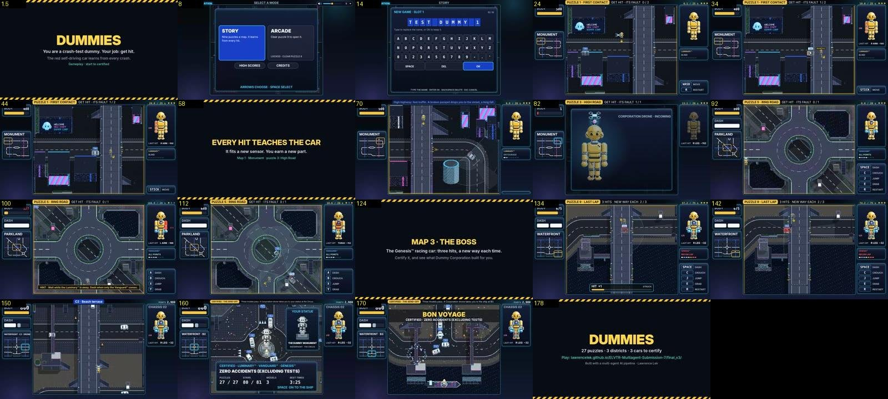

# DUMMIES GDD — Edit 129: FINAL V3.2. The unveiling, the ship, the submission

**14 November 2026 · Lawrence Lek.** Builds on Edit 128. Governs FINAL V3 (`final_v3/`, same link). The newest edit wins.

- **Request (14 Nov, 00:02):**
  - "We do NOT see the statue unveiling at the end of the third map, before the drone goes to the ship in the sea."
  - "It should also pause a moment after the drone goes to the ship in the sea, add some juice to celebrate it."
  - The final project brief: a playable build, a README (how to play), a 2–3 minute gameplay video.
- **Cause:** the V3 unveiling ran (Edit 127), but it was too quiet to read as an event.
  - The cloth lifted in 1.2 s.
  - The plaque covered the field 0.7 s later.
  - The statue is 30 px tall.
- **`final_v2/`:** never had the unveiling.

## 129.1 The unveiling

| t (s) | Beat | Parameter |
|---|---|---|
| 0–1.0 | Under the cloth. THE UNVEILING stamps in. Two spotlights sweep onto the statue | `ui.finale.unveilHoldSeconds` 1.0 (proposed) |
| 1.0–2.2 | The drone lifts the cloth. The chime (`unveil-lift`) | `ui.finale.unveilSeconds` 1.2 |
| 2.2 | A white flash and a shake. A spark ring at the statue. 170 pieces of confetti. A fanfare | — |
| 2.35– | YOUR STATUE: a close-up card with the statue's own sprite, trimmed and scaled | — |
| 3.5– | The plaque fades in | — |
| 4.6– | SPACE ON TO THE SHIP | `ui.finale.closeupSeconds` 2.4 (proposed) |

- **Reduced motion:** no confetti, sparks or shake.

## 129.2 On the ship

- **Phase:** `cheer` follows the voyage's landing. It lasts 4.5 s (`ui.finale.cheerSeconds`, proposed), then CERTIFIED.
- **Sound:** the ship's horn twice, then a fanfare.
- **Picture:**
  - A firework every 0.42 s over the harbour.
  - Confetti and a pulse ring on the ship.
  - BON VOYAGE, with "CERTIFIED · ZERO ACCIDENTS (EXCLUDING TESTS)".
- **World:** paused. The effects run in real time.

## 129.3 Text fix

- **Map 2, puzzle 5 card:** "Luminary™ · it sees ahead and beside, and it tells". It was "it sees all round" (Edit 128 retired the ring).

## 129.4 The submission

| Item | Where |
|---|---|
| Playable build (hosted) | https://lawrencelek.github.io/ELVTR-Multiagent-Submission-7/final_v3/ |
| Playable build (ZIP) | `DUMMIES_playable.zip`: `index.html` (one self-contained file) and `README.md` |
| README (how to play) | `README.md`. The build history moves to `BUILD_LOG.md` |
| Gameplay video | `docs/dummies_gameplay.mp4`, 2:59, 1280 × 720, 30 fps, with the game's sound |

**The video:**
- Start: the intro, the title, a new game, the grid, Map 1 puzzle 1, its lesson.
- Puzzle 3 and its part (Battery 1).
- Map 2, puzzle 5: the hint after failed passes, a restart, the clear.
- Map 3's boss: RECON LAP learned, the last two hits, the result.
- The send-off: the flight to the statue, the unveiling, the plaque, the voyage, BON VOYAGE, CERTIFIED.
- Real inputs throughout: keys and the virtual pad; the boss by the cut-in bot.

**Recording (`qa/video.js`):**
- Records over HTTP. The sound engine is silent on `file://`.
- A tap on the page's Web Audio output records the sound.
- Each scene is cut and encoded once, then the scenes are joined with `-c copy`.

## 129.5 Tests

| Test | Result |
|---|---|
| The send-off from the result card, browser | Tour, unveiling (beat, lift, burst, close-up, plaque), voyage, cheer 4.4 s, CERTIFIED. No page errors |
| `qa/models.js` | 9 of 9 |
| The video's scenes, browser | Four scenes, no page errors. The boss took 6 min 46 s (the bot); the video shows its last minute |

## 129.6 Files

- **`engine/build_p9.py`:** `v3_game_js`, with `CELEBRATE_JS` (`celebrateUnveil`, `drawCheer`, confetti, sparks, banners). The unveil timing.
- **`engine/p11.js`:** the `cheer` phase (`CHEER_S`).
- **`engine/p11_goto.js`:** `P11_URL` (HTTP).
- **`content/puzzles_map2.json`:** B2's line.
- **`qa/video.js` (new):** the recorder.
- **`README.md`** (how to play), **`BUILD_LOG.md`** (the old README).
- **`docs/dummies_gameplay.mp4`.**
