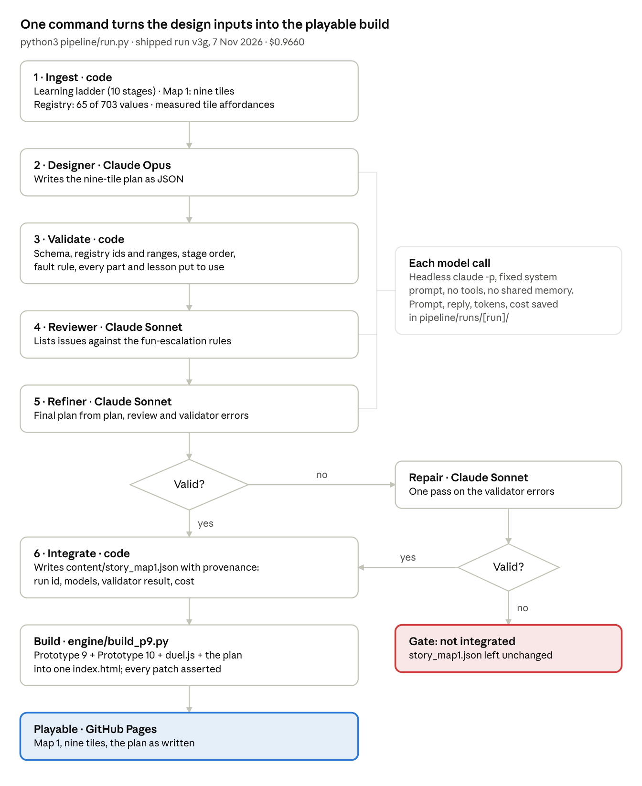
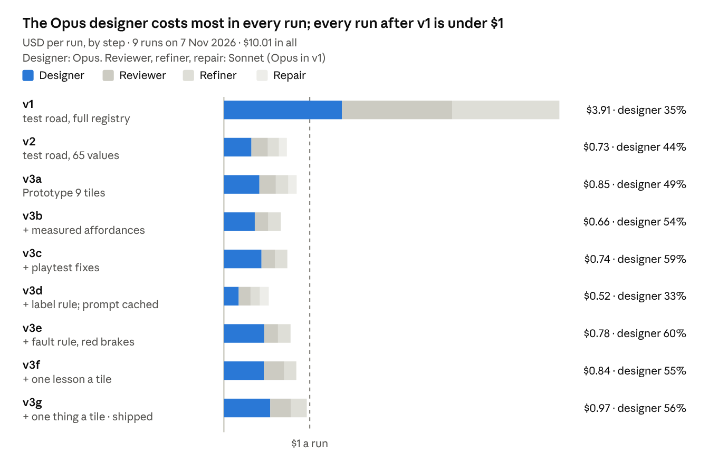

# DUMMIES — Assignment 7: Complete AI Dev Pipeline

**11 November 2026 · Lawrence Lek**

An agent pipeline writes Map 1's level plan; the browser game loads it unchanged. Shipped run v3g cost $0.9660. Play: https://lawrencelek.github.io/ELVTR-Multiagent-Submission-7/

## Student & Game Overview

| Field | Answer |
|---|---|
| **Student Name** | Lawrence Lek |
| **Capstone Game Title** | DUMMIES |
| **Game Concept Brief** | A top-down browser game. You are a crash-test dummy in a smart city. You score by getting hit by a self-driving car that learns. Each crash teaches it a new sensor, which closes the trick you used. The pipeline designs Story Map 1: nine tiles, the car's learning order, each tile's goal, card text and hint. |

## Deliverable 1: Playable Link

**Playable Game Link:** https://lawrencelek.github.io/ELVTR-Multiagent-Submission-7/

- **Host:** GitHub Pages, one static page. No install, no login, no download. Desktop browser with a keyboard.
- **No instructions needed.** Every screen names its keys:
    - Title: SPACE START.
    - Menus: ARROWS CHOOSE · SPACE SELECT.
    - Name entry: ENTER OK.
    - Tile card: the goal. "1 damaging hit by the red car. Open road: walk into its path; let it hit you."
    - In play: WASD MOVE.
- **Checked 11 Nov 2026:** a scripted first-time player reached play in about 10 key presses, under a minute. No page errors.

## Deliverable 2: Pipeline Source Code & Engine Integration

**Pipeline Repository Link:** https://github.com/lawrencelek/ELVTR-Multiagent-Submission-7

**Pipeline Run Video Link:** https://lawrencelek.github.io/ELVTR-Multiagent-Submission-7/docs/pipeline_run.mp4 (2 min 48 s)

- 0:00–0:56: the v1, v2 and v3g runs, replayed from their own logs with recorded timestamps. Model waits are shortened and labelled.
- The shipped run, v3g, ends: `wrote content/story_map1.json`, `wrote index.html`, run cost $0.9660.
- Then the plan it wrote: nine tiles, goals, titles, provenance.
- 0:56 on: the game playing that plan, tile 1 onward.

### Integration Breakdown

**Target Game Engine:** a custom HTML5 Canvas 2D engine in plain JavaScript, running in the browser. Prototype 9's game with Prototype 10's car AI. No framework.

**Automated Flow Description:** one command, `python3 pipeline/run.py`. Agents write a JSON plan. Code validates it. The integrate step writes `content/story_map1.json`, and `engine/build_p9.py` bundles it into `index.html`. The engine reads the file as written: no hand edits, no reformatting.

| Plan field | What the engine does with it |
|---|---|
| `stage` | Loads that stage of the car's learning ladder: start rung, top rung, sensors |
| `params` | Applies registry overrides; ids and ranges validated first |
| `objective` | Sets the hits needed to clear the tile; shown in the HUD |
| `title`, `tale`, `hint`, `newIdea` | Fill the tile card, the objective line and the NEW line |
| `provenance` | Records run id, models, validator result, cost |

- **Gate:** a plan that fails validation after one repair is not integrated.
- **One manual step remains:** publishing. A `git push` puts the build on GitHub Pages.

## Deliverable 3: Pipeline Audit & Cost Analysis (1 page)

### Pipeline Production & Functionality

**What did the pipeline produce?** Map 1's level plan, `content/story_map1.json` (run v3g). All nine tiles of the build play from it:

- the car's learning order: one new sensor or dummy part per tile;
- each tile's goal, shown in the HUD: "LET IT HIT YOU", "DROP INTO ITS PATH", "DUCK, THEN DASH";
- nine tile titles and tales: "The welcome wall": "Fresh off the factory floor. Your first colleague is red, keen and blind.";
- nine hints that name the tile's cover: "Hide behind the kiosk at the kerb; step into its path late.";
- two tuning overrides: A1 `duel.redReturnSeconds` 3; C1 `ui.lungeGuide` 1.

The file carries its provenance: run id, models, validator result, cost. Per-tile list: Appendix A.

**What manual steps remain?**

- Publishing: a `git push` to GitHub Pages.
- Prototypes 9 and 10 were copied into the repo by hand (md5s in `VENDOR.md`).
- Difficulty: headless bot probes are run and read by hand.
- Fun: a person plays and judges.

**What would it take to eliminate them?**

- One GitHub Action on push: run the pipeline, test the nine tiles, deploy Pages, render the video.
- `pipeline/vendor.py`: fetch a pinned Submission 6B commit and check the md5s.
- Run the probes (`engine/p9_probe.js`) inside ingest. Feed hits a minute to the designer as a measured fact.
- Fun stays human. A recorded bot session per tile in CI shortens the review.

### Architectural Reflection

**Current Architectural Decision to Change:** joining the two prototypes by patching. The red car's AI (Prototype 10) enters Prototype 9's traffic at runtime. `engine/duel.js` swaps the tile's sim for a subclass, and the build string-patches `game.js`. It works, but it depends on seven internal names: `admit`, `meets`, `level.statics`, `manSpeed`, `watchField`, `spawnSpeed`, `searchStep`. Any upstream rename breaks a patch.

**Specific Alternative:** a driver interface in the engine. Prototype 9's traffic sim calls `driver.perceive(world)`, `driver.decide(dt)` and `driver.onContact(hit)` for every vehicle. The fleet keeps the default driver. The red car gets Prototype 10's brain as a driver module, configured by the plan's `stage`. No patches: the build only bundles.

### Cost Analysis

**Total Actual Run Cost: $0.9660.** The shipped content run, v3g (`pipeline/runs/20261107-182619-v3/costs.json`): 3 model calls, 122,091 input and 33,034 output tokens, 4 min 15 s.

**Most Expensive Pipeline Step:** the designer, on Claude Opus: $0.5396, 56% of the run. It writes the longest reply (15,488 output tokens) at Opus rates. Reviewer (Sonnet) $0.2406; refiner (Sonnet) $0.1858.

**Solo/Small-Team Sustainability:** yes. A content run costs $0.52–$0.97. Three maps × 10 iterations cost $16–$29. Every agent tool used on Map 1 cost $28.68 recorded. The game makes no model calls at runtime, so players cost nothing.

### Mid-Project Cost-Reduction Change

| | Before (v1) | After (v2) |
|---|---|---|
| **Strategy/Prompting Approach** | Full registry (703 values) in every prompt. Opus for designer, reviewer and refiner | Registry filtered to the 65 values the ladder uses. Opus designer only; Sonnet reviewer, refiner, repair |
| **Token / API Cost** | 461,915 input tokens · $3.9092 a run | 126,199 input tokens · $0.7343 a run (−81%) |

## Appendix: evidence behind the audit

### A. The nine tiles the pipeline planned

| Tile | Stage | Goal in the HUD | Card title | One new thing |
|---|---|---|---|---|
| A1 | 10.2 | LET IT HIT YOU × 1 | The welcome wall | Car learns the forward camera |
| B1 | 10.3 | STEP OUT AT THE KERB × 1 | The podium bridge | Dummy earns Battery 1 (dash) |
| C1 | 10.3 | DASH INTO ITS PATH × 2 | The LED drum | Car learns side sensors |
| C2 | 10.4 | DROP INTO ITS PATH × 1 | The portal tower | Dummy earns Hands 1 (cone) |
| B2 | 10.4 | CONE-BAITED HIT × 1 | The monument | Dummy earns Legs 1 (jump) |
| A2 | 10.4 | JUMP INTO ITS PATH × 1 | The neon shops | Car learns roof lidar |
| A3 | 10.5 | DASH FROM COVER × 1 | The stacked cubes | Dummy earns Super Knees (duck) |
| B3 | 10.5 | DUCK, THEN DASH × 1 | The LED canyon | Car learns street cameras |
| C3 | 10.6 | UNSEEN DASH × 1 | The LED gateway | Car learns road items |

- **Checks:** validator 0 errors. The reviewer asked for a revision (tiles 7–8 needed tricks their stage cannot offer); the refiner fixed it; validator 0 errors.
- **In the build, re-tested 11 Nov 2026:** `engine/p9_tiles_test.js`: 9 of 9 tiles start with the plan's stage, rung, goal and cover; no page errors.

### B. Cost of every content run

*Source: `pipeline/runs/*/costs.json` · 9 content runs, 30 model calls, 7 Nov 2026.*

- **Content pipeline total:** $10.0053 over 9 recorded runs, 30 calls. Two runs stopped at the gate left no record (about $1 each).
- **Cache:** run back to back, the designer's prompt stays cached. v3d's designer read 32,143 tokens from cache: $0.17, against $0.44 in v3c.

### C. Every agent tool used on Map 1

| Agent (script) | Runs | Recorded cost |
|---|---|---|
| Content pipeline (`run.py`) | 9 | $10.01 |
| Adversarial QA (`qa_attack.py`) | 1 (3 calls) | $4.55 |
| Car design (`car_design.py`) | 2 (8 rounds) | $4.88; 4 rounds unrecorded, about $5 |
| Upgrade-screen redesign (`ui_upgrade.py`) | 4 | $4.46 |
| UI review (`ui_review.py`) | 2 | $3.85 |
| Puzzle pressure test (`pressure_test.py`) | 1 | $0.94 |
| **Total** | **19** | **$28.68 recorded; about $36 with unrecorded calls** |

- **Lost records, fixed 11 Nov:** resumed runs kept call costs only in memory. `pipeline/llm.py` now appends every call to `calls.jsonl` in its run folder. Testing that fix spent $0.16.
- **Not metered here:** the Claude Code sessions that built the pipeline and engine (subscription).

### D. The v1 to v2 reduction in detail

| | v1 | v2 | Change |
|---|---|---|---|
| Registry sent | 703 entries | 65 entries | −91% |
| Agent input | 296,724 characters | 27,432 characters | −91% |
| Input tokens | 461,915 | 126,199 | −73% |
| Output tokens | 18,864 | 20,959 | +11% |
| Cost a run | $3.9092 | $0.7343 | −81% |

- **Where it came from:** the filter alone cut the Opus designer by 77% ($1.3757 to $0.3205). The Sonnet swap cut reviewer and refiner by 84%.
- **Quality held:** v2 passed the same validator, after one repair. v3b, with Prototype 9's tiles and measured facts, cost $0.66 and needed no repair.

### E. Beyond the submission: Shipping V1

The puzzle version of Map 1: https://lawrencelek.github.io/ELVTR-Multiagent-Submission-7/p11/. Its puzzle data is written by hand. Agent output inside it:

- **Hero cars:** `engine/hero_cars.js`, written by the car design agent over 4 self-review rounds. Bundled as written, except one sentence. Three cars, 21 parts.
- **Upgrade screen:** from the adversarial UI redesign agent's spec and three review rounds.
- **QA:** an adversarial QA agent played the nine puzzles through a virtual pad: 87 attack plans, 15 bug reports (GDD Edit 118).

## Rubric map

| Criterion | Points | Where it is met |
|---|---|---|
| Playable Link | 2.0 | Deliverable 1: one URL; every screen names its keys; play in under a minute |
| Pipeline-to-Game Connection | 3.0 | Video: the run log writes `story_map1.json`, then the game plays it. Deliverable 3: what the pipeline produced. Appendix A: the nine tiles; provenance in the file |
| Engine Integration | 2.0 | Deliverable 2: Automated Flow Description and field table. One documented manual step: publishing |
| Cost Analysis | 2.0 | Deliverable 3: Cost Analysis, from the actual run. Appendix B and C |
| Pipeline Audit | 1.0 | Deliverable 3, one page, every field of the brief. Detail in the Appendix |

## Sources

- [Playable build](https://lawrencelek.github.io/ELVTR-Multiagent-Submission-7/) · [Shipping V1, puzzles](https://lawrencelek.github.io/ELVTR-Multiagent-Submission-7/p11/)
- [Repository](https://github.com/lawrencelek/ELVTR-Multiagent-Submission-7) · [README](../README.md)
- [Pipeline-run video](https://lawrencelek.github.io/ELVTR-Multiagent-Submission-7/docs/pipeline_run.mp4) · [Shipping V1 runthrough video (Appendix E)](https://lawrencelek.github.io/ELVTR-Multiagent-Submission-7/docs/p11_runthrough.mp4)
- [The plan, `content/story_map1.json`](../content/story_map1.json) · [run folders, `pipeline/runs/`](../pipeline/runs/)
- [Pipeline audit, `docs/02_Pipeline_Audit.md`](02_Pipeline_Audit.md) · [Prototype 9 × 10 integration analysis](01_P9_P10_Integration_Analysis.md)
- GDD: [Edit 111, Submission 7 integration](DUMMIES_GDD_Edit111_Submission7_Integration.md) · [Edit 118, QA agent](DUMMIES_GDD_Edit118_Prototype_11_2_QA_Runthrough.md) · [Edit 121, car design agent](DUMMIES_GDD_Edit121_Prototype_11_5_Liveries_Genesis_Part_Names.md)
